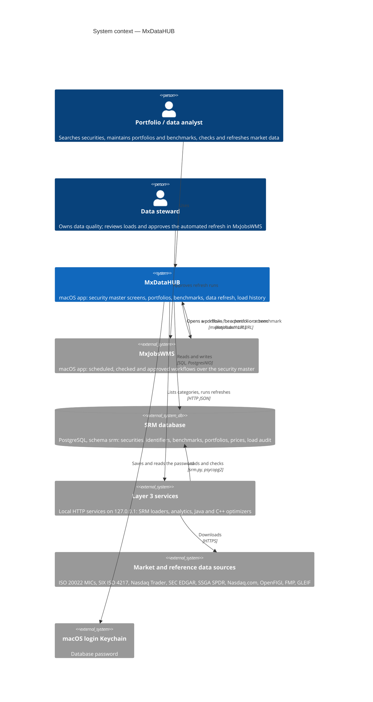

# 01 · System context (C4 level 1)

MxDataHUB keeps the **security reference master**: which securities exist, how every identifier maps to them over
time, which benchmarks and portfolios hold them, and whether each category of market data is up to date. People use
it to look up and maintain that data; MxJobsWMS automates the processes that run over it.

## Actors

| Actor | Goals in MxDataHUB |
|---|---|
| **Portfolio / data analyst** | Find a security by any identifier; see its identifiers, issuer, listings, prices, benchmarks and corporate actions; keep portfolios' dated holdings; compare a portfolio with its benchmark; build custom benchmarks; refresh stale data. |
| **Data steward** | Watch identifier coverage, snapshot history and the load audit trail (Load History); run or preview refreshes; hand the daily refresh to MxJobsWMS, where it runs on a schedule with approval. |

## External systems

| System | Relationship | Notes |
|---|---|---|
| **SRM database** (PostgreSQL) | System of record. MxDataHUB reads it and makes small, single-statement changes (portfolios, holdings, custom benchmarks). | Created and migrated by `SRM/srm.py migrate`; app checks that schema `srm` exists after connecting. |
| **Layer 3 services** | MxDataHUB calls the **srm-loader** service to list data categories and run refreshes; the other services appear in Services & Workflows (state, purpose, endpoints). | 127.0.0.1 only; started with `Services/mxservices.py`. The loaders run outside the app's sandbox. |
| **Market and reference data sources** | Reached only by the loaders, never by the app. | Plans and limits per source are in `SRM/README.md` and on Load History. |
| **MxJobsWMS** | Peer app. Hand-offs both ways through URL schemes. | Data (HUB) vs processes (WMS) split — see [ADR-0009](adr/0009-data-and-process-apps-linked-by-url-schemes.md). |
| **Login Keychain** | Holds the database password when *Save password in Keychain* is on. | Item `MxDataHUB: user@host:port/database`. |

## Scope

In scope: interactive look-up and maintenance of the security master, portfolio and benchmark maintenance, data
freshness and on-demand refresh, load audit. Out of scope (by design): scheduling, approval and orchestration
(MxJobsWMS), optimization and risk computation (Layer 3 services), bulk loading logic (SRM loaders).
