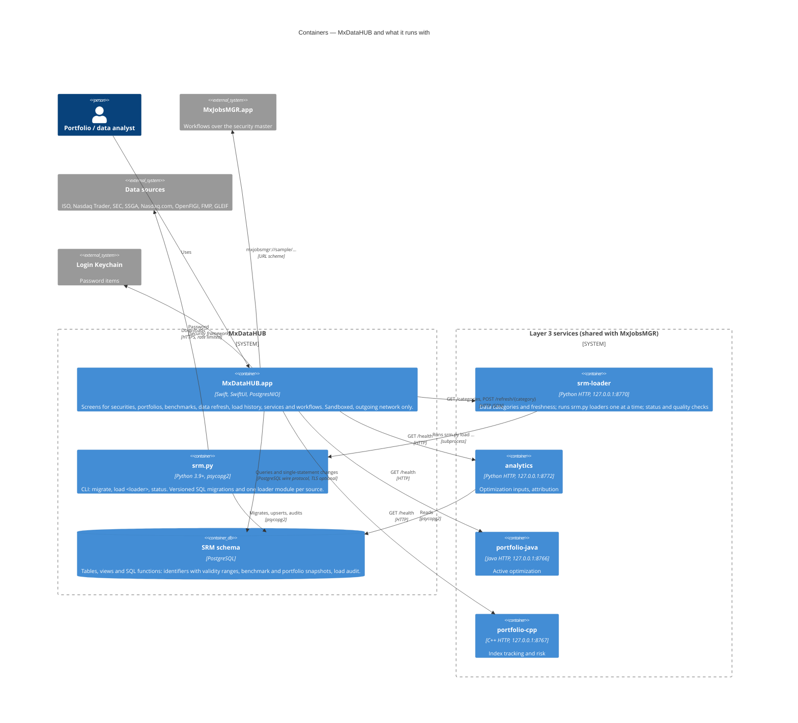

# 02 · Containers (C4 level 2)

A *container* here is a separately running or separately deployed unit: the app, a service process, the database.

## Containers

| Container | Technology | Responsibility | Owns |
|---|---|---|---|
| **MxDataHUB.app** | Swift 5 mode, SwiftUI, Observation, PostgresNIO; macOS 26.6+ | Interactive look-up and maintenance; data freshness; hand-offs to MxJobsMGR. Every change it makes is one SQL statement, committed on its own. | Connection settings (UserDefaults), the database password (Keychain), no data of its own |
| **SRM schema** | PostgreSQL | System of record. Business rules that must hold for every writer (identifier validity, one value per security and type at a time, snapshot rebuilds) live here as constraints and SQL functions. | All SRM data and the load audit (`load_run`, `load_reject`) |
| **srm.py** | Python 3.9+, psycopg2, standard library | Schema migrations (checksummed, in order) and the loaders, one module per source, in dependency order. Writes are upserts, so loaders can be re-run. | Migrations, loader logic, source limits |
| **srm-loader service** | Python `http.server`, 127.0.0.1:8770 | HTTP front for srm.py: data categories with freshness, `POST /refresh/{category}` and `/load/{loader}` (one load at a time, `X-SRM-Dry-Run: 1` previews), `GET /status`. | Category → loader mapping, freshness rules |
| **analytics, portfolio-java, portfolio-cpp, market-sample** | Python, Java, C++ HTTP services | Used by MxJobsMGR workflows; MxDataHUB only shows their state and purpose. | Their computations |

## Interfaces

| From → to | Interface | Details |
|---|---|---|
| App → SRM schema | PostgreSQL protocol via PostgresNIO | SSL `disable` / `prefer` / `require` (no certificate verification, as libpq). After connecting: `to_regclass('srm.security')` decides whether the screens are available. Reads use views (`v_security`, `v_identifier_coverage`, `v_benchmark_summary`, `v_load_history`, `v_snapshot_coverage`) and functions (`resolve_identifier`, `benchmark_weights`, `portfolio_valuation`, `portfolio_validate`, `portfolio_active_weights`, `last_price`); writes use `srm.add_holding`, `srm.build_benchmark` and plain `INSERT`/`UPDATE`/`DELETE` on `portfolio` and `portfolio_holding`. |
| App → srm-loader | HTTP JSON, `http://127.0.0.1:8770` | `GET /categories` → categories with loaders, state (fresh, due, stale, failed), data date, last run. `POST /refresh/{id}` (timeout 3 h) → per-loader status, seconds, command, totals, output tail. Header `X-SRM-Dry-Run: 1` for *Preview only*. |
| App → every service | `GET /health` (1.5 s timeout, all services in parallel) | Running or not, shown in Services & Workflows. What each service is for comes from the built-in `ServiceCatalog`, which mirrors each service's `GET /describe`, so the app can explain a service and how to start it while it is stopped. |
| App ↔ MxJobsMGR | URL schemes | `mxjobsmgr://sample/<id>?portfolio=&benchmark=`; back: `mxdatahub://portfolio/<CODE>`, `benchmark/<CODE>`, `data-refresh`, `services`. Defined once in `Shared/AppLinks.swift`. |
| srm.py → sources | HTTPS | Rate limited per source; keys from environment, Keychain (`SRM-api`) or `config.local.json`; keys redacted from logs and `srm.load_run`. |

## Why these boundaries

- The **sandboxed app cannot run Python** or reach the loaders' secrets, so refresh goes through a local service —
  [ADR-0005](adr/0005-data-refresh-through-local-loader-service.md).
- **Rules live in the database** so the app, the loaders and the analytics service all get the same answers —
  [ADR-0002](adr/0002-postgresql-srm-schema-as-system-of-record.md).
- **No API tier** between the app and the database: one user, one LAN database, small single-statement changes —
  [ADR-0003](adr/0003-direct-database-access-with-single-statement-changes.md).
