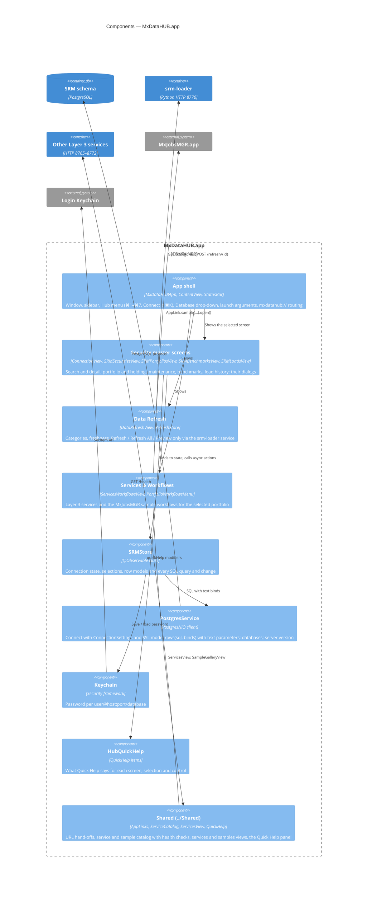

# 03 · Components of MxDataHUB.app (C4 level 3)

The app is one window (`Window("MxDataHUB")`) with a sidebar of seven screens. State is held in one observable
store; screens are thin SwiftUI views over it. Code shared with MxJobsMGR is compiled in from `../Shared`.

## Components

| Component | Files | Responsibility | Notes |
|---|---|---|---|
| **App shell** | `MxDataHUBApp.swift`, `ContentView.swift` | The single window and its **Hub** menu; sidebar of `SRMSection`s; shows *Not Connected* or *No Security Master Here* instead of a screen when needed; the toolbar **Database** drop-down; the status bar; `onOpenURL` for `mxdatahub://`; launch arguments (`-autoConnect`, `-section`, `-query`, `-servicesTab`, connection fields; `PGPASSWORD` in Debug). | DB Connection, Data Refresh and Services & Workflows work without a database connection. |
| **Security master screens** | `ConnectionView`, `SRMSecuritiesView`, `SRMPortfoliosView` (+ `PortfolioDialog`, `AddHoldingDialog`, `PasteHoldingsDialog`), `SRMBenchmarksView` (+ `BuildBenchmarkDialog`, `BenchmarkAvailabilitySheet`), `SRMLoadsView` | Presentation and input; no SQL. | See the [UI screen catalog](ui-screen-catalog.md). |
| **Data Refresh** | `DataRefreshView.swift` (`RefreshStore`, `RefreshCategory`, `RefreshResult`) | Its own small store: loads `/categories`, runs `/refresh/{id}` one at a time, *Refresh All* stops at the first failure and skips optional categories; *Preview only* sends `X-SRM-Dry-Run: 1`. | Independent of the database connection — the service has its own. |
| **Services & Workflows** | `ServicesWorkflowsView.swift` | Segmented *Workflows* / *Layer 3 Services*; opens a sample in MxJobsMGR for the portfolio selected in Portfolios (and its benchmark). `PortfolioWorkflowsMenu` is the Portfolios screen's **Workflows** menu. | Uses `ServicesView` and `SampleGalleryView` from `../Shared`. |
| **SRMStore** | `SRMStore.swift` | The app's model: connection status and settings, the selections of every screen, row types (`SecurityRow`, `HoldingRow`, `BenchmarkRow`, `LoadRow`, …) and every query. Async actions: `connect`, `switchDatabase`, `search`, `loadDetail`, `savePortfolio`, `newSnapshot`, `addHoldings`, `normalizeWeights`, `copyBenchmark`, `buildBenchmark`, `loadAudit`, … | One store for one window; errors surface as `errorMessage` (an alert) or a failed connection status. |
| **PostgresService** | `PostgresService.swift` | Owns the PostgresNIO connection. `rows(_:_:)` runs SQL with **text binds** (`$1…`) and returns text cells; `databases()`, `serverVersion()`. `ConnectionSettings` (host, port, user, database, SSL mode, *save password*) persist in `UserDefaults`. `DatabaseError.from` turns driver errors into readable messages. | Parameterised SQL only — values are never interpolated. |
| **Keychain** | `Keychain.swift` | Generic password per `MxDataHUB: user@host:port/database`. | Debug builds can also take `PGPASSWORD`. |
| **HubQuickHelp** | `HubQuickHelp.swift` | Text for the shared Quick Help panel: screens, why a screen is empty, the selection, each control. | Panel docks at the bottom of the sidebar. |
| **Shared** | `../Shared/AppLinks.swift`, `ServiceCatalog.swift`, `ServicesView.swift`, `QuickHelp/QuickHelp.swift` | Compiled into both apps (file-system synchronized group). `AppLink` builds and parses `mxjobsmgr://` / `mxdatahub://` URLs; `ServiceCatalog` lists the five services, their use cases, endpoints and the five samples, and checks `GET /health`. | [ADR-0010](adr/0010-shared-swift-sources-compiled-into-each-app.md) |

## Dependencies and rules

- Views never talk to PostgreSQL or HTTP directly; they call `SRMStore` (database) or `RefreshStore` (srm-loader).
- All Swift types default to `@MainActor` (`SWIFT_DEFAULT_ACTOR_ISOLATION = MainActor`); value types that cross to
  background work are `nonisolated` and `Sendable` (`ConnectionSettings`, `DatabaseError`, the shared catalog types).
- No component writes more than one SQL statement per user action: there are no client-side transactions
  ([ADR-0003](adr/0003-direct-database-access-with-single-statement-changes.md)).
