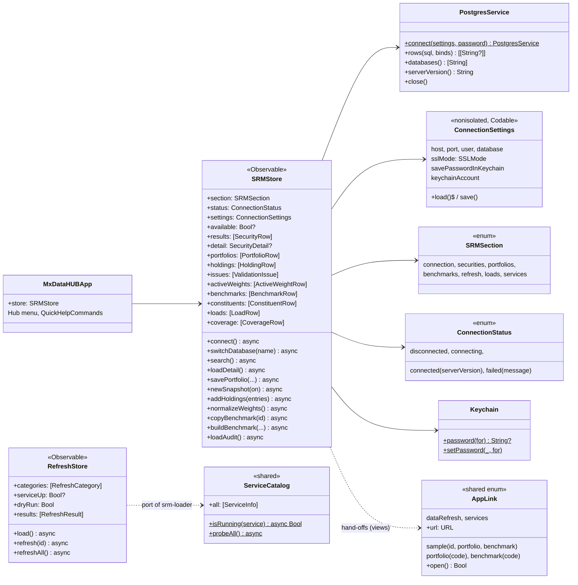
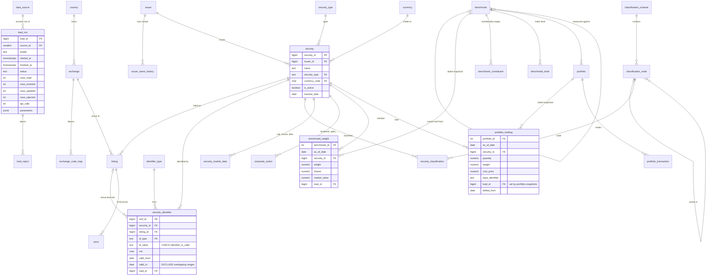

# 04 · Code and data model (C4 level 4)

## Swift model

`SRMStore` maps query results to small `Identifiable` row structs (`SecurityRow`, `IdentifierRow`, `ListingRow`,
`ActionRow`, `PricePoint`, `PortfolioRow`, `HoldingRow`, `ValidationIssue`, `ActiveWeightRow`, `ResolveMatch`,
`BenchmarkRow`, `ConstituentRow`, `SectorWeight`, `LoadRow`, `CoverageRow`, `SnapshotCoverageRow`, `SourceRow`) that
the screens show in SwiftUI `Table`s and charts. `PostgresService.rows` returns text cells, which the store parses.

## The `srm` schema (system of record)

Created by `SRM/srm.py migrate` from `SRM/migrations/V001…V010` (checksummed, applied in order).

### SQL functions the app relies on

| Function | Used by | What it guarantees |
|---|---|---|
| `resolve_identifier(text, type, as_of)` | Securities search, Add Holding | Any identifier (ISIN, CUSIP, SEDOL, FIGI, ticker, `TICKER:MIC`, `TICKER US`, CIK, LEI) → securities, best match first, as of a date |
| `add_holding(portfolio, date, identifier, shares, weight, type)` | Add / Paste Holdings | Resolves and inserts in one statement |
| `benchmark_weights(benchmark, as_of)` | Benchmarks, Copy Benchmark, vs Benchmark | The snapshot in force on a date |
| `build_benchmark(code, name, parent, 'equal'\|'cap', sector, as_of)` | Build Custom… | Creates a custom benchmark from another's members |
| `portfolio_valuation`, `portfolio_validate`, `portfolio_active_weights` | Portfolios | Market value with latest prices; checks (weights sum to 100 %, prices present and recent, inactive or short positions); active weights and active share |
| `last_price` | Securities, Portfolios | Latest EOD price for a listing |

Rules enforced in the database rather than the app (see [ADR-0002](adr/0002-postgresql-srm-schema-as-system-of-record.md)
and [ADR-0007](adr/0007-identifiers-with-validity-ranges-in-the-database.md)): identifier format and check digits
(`CHECK`), one security per identifier value at a time and one current value per security and type (`EXCLUDE`
constraints on validity ranges), benchmark membership rebuilt from all snapshots (`apply_benchmark_snapshot`).
