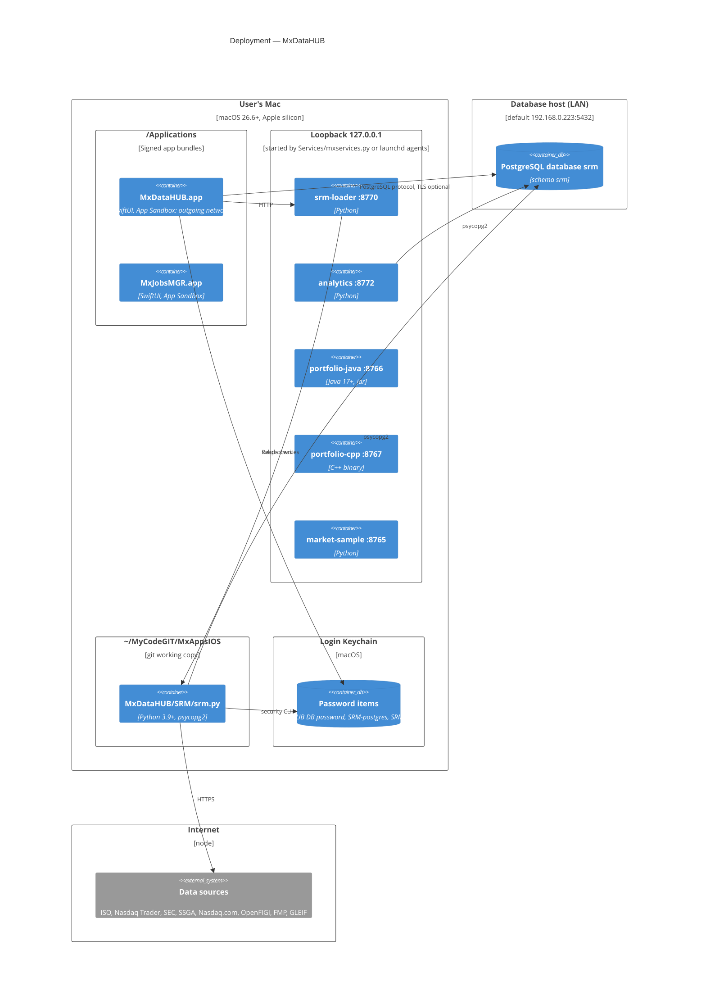

# 05 · Deployment

Everything except the database and the data sources runs on the user's Mac. The services listen on the loopback
interface only.

## Nodes

| Node | What runs there | How it gets there | Notes |
|---|---|---|---|
| **Mac, /Applications** | `MxDataHUB.app` (`com.k3jdr.MxDataHUB`) | Release build re-signed with the Apple Development certificate (team QC4VX47BJ8), installed with `ditto`, registered with `lsregister`; also zipped to `~/Downloads/MxDataHUB-1.0.zip` | App Sandbox; outgoing network only. Registers `mxdatahub://`. |
| **Mac, loopback** | The five Layer 3 services | `python3 Services/mxservices.py start` (builds the Java jar and C++ binary the first time); optionally `install-agents` writes `~/Library/LaunchAgents/com.k3jdr.mxservices.*.plist` | Logs in `~/Library/Logs/MxServices/`. Outside the sandbox, so they can use files, credentials and packages. |
| **Mac, git working copy** | `srm.py`, migrations, loaders | `~/MyCodeGIT/MxAppsIOS` | srm-loader finds it at `../../MxDataHUB/SRM` (or `--srm-dir`). |
| **Login Keychain** | Secrets | App (*Save password in Keychain*); `security add-generic-password -s SRM-api -a fmp …` for loader keys | Never in the repository; `config.local.json` is git-ignored. |
| **Database host** | PostgreSQL with schema `srm` | `srm.py migrate` | Default `postgres@192.168.0.223:5432/srm`; the app can switch databases on the same server. |
| **Internet** | The data sources | — | Rate limits and plans in `SRM/README.md` and Load History ▸ Sources. |

## Operational notes

- **Order of start-up does not matter**: the app shows *SRM Loader Service Not Running* (with *Check Again*) on Data
  Refresh and service states on Services & Workflows; the security-master screens need only the database.
- **Long loads**: a refresh request waits up to 3 hours (`POST /refresh/{id}` timeout); the service runs one load at
  a time.
- **Testing**: launch arguments `-autoConnect YES -section Portfolios -query AAPL`, connection fields as arguments,
  `PGPASSWORD` in Debug builds.
