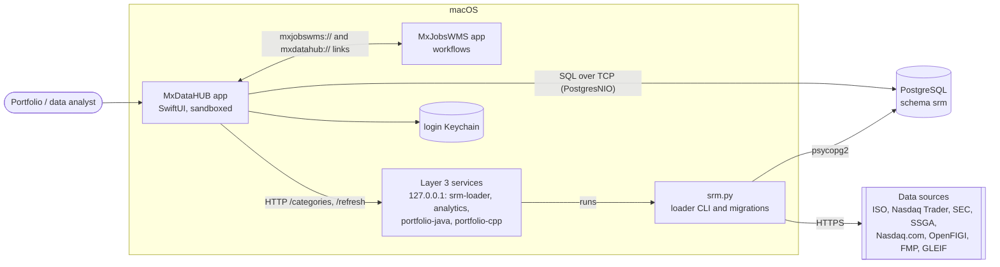

# MxDataHUB — architecture

MxDataHUB is a native macOS business application (Swift, SwiftUI) for the **security reference master (SRM)**:
securities and their identifiers, issuers and listings, benchmarks and portfolios, and the freshness of each category
of market data. The data lives in PostgreSQL (schema `srm`) and is loaded from free and subscribed sources by Python
loaders. MxDataHUB is **the data** half of a pair: its sibling [MxJobsWMS](../../MxJobsWMS/c4/README.md) runs **the
processes** (scheduled, checked, approved workflows) over that data, and both use the same **Layer 3 services**.

This folder documents the architecture with the [C4 model](https://c4model.com), Architecture Decision Records, a UI
screen catalog and workflow diagrams. Diagrams are [Mermaid](https://mermaid.js.org) (rendered by GitHub and most
Markdown viewers); [`workspace.dsl`](workspace.dsl) holds the same C4 model for [Structurizr](https://structurizr.com).

| Document | What it covers |
|---|---|
| [01 · System context](01-system-context.md) | Who uses MxDataHUB and which systems it depends on (C4 level 1) |
| [02 · Containers](02-containers.md) | The app, the SRM database, the loader CLI and the Layer 3 services (C4 level 2) |
| [03 · Components](03-components.md) | Inside the app: screens, the store, the database and service clients, shared code (C4 level 3) |
| [04 · Code and data model](04-code.md) | Key Swift types and the `srm` schema (C4 level 4) |
| [05 · Deployment](05-deployment.md) | Where each part runs: the Mac, the database host, the internet |
| [ADRs](adr/README.md) | Architecture decisions, with context and consequences |
| [UI screen catalog](ui-screen-catalog.md) | Every screen and dialog: purpose, entry points, controls, data, states |
| [Workflows](workflows.md) | User and data workflows as diagrams: connect, search, portfolios, benchmarks, data refresh, hand-offs |

## The system on one page

## Facts at a glance

| | |
|---|---|
| Platform | macOS 26.6+, Swift 5 language mode, SwiftUI with Observation, default `MainActor` isolation |
| Bundle | `com.k3jdr.MxDataHUB`, URL scheme `mxdatahub://` |
| Sandbox | App Sandbox with outgoing network connections only |
| Dependencies | [PostgresNIO](https://github.com/vapor/postgres-nio) (Swift package); `../Shared` sources compiled in |
| Data | PostgreSQL schema `srm` (migrations `V001`–`V010`), default `postgres@192.168.0.223:5432/srm` |
| Size | ~3,100 lines of Swift in the app, ~1,100 shared; loaders in `SRM/` (Python) |
| Sources of truth | Code in `../MxDataHUB/`, `../Shared/`, `../Services/`; [README](../README.md), [SRM/README](../SRM/README.md), [Services/README](../../Services/README.md) |

*Recorded 2026-10-17 from the code on `main` at commit `6545216`. The ADRs are written retrospectively: they
document the decisions the code embodies, not a meeting record.*
