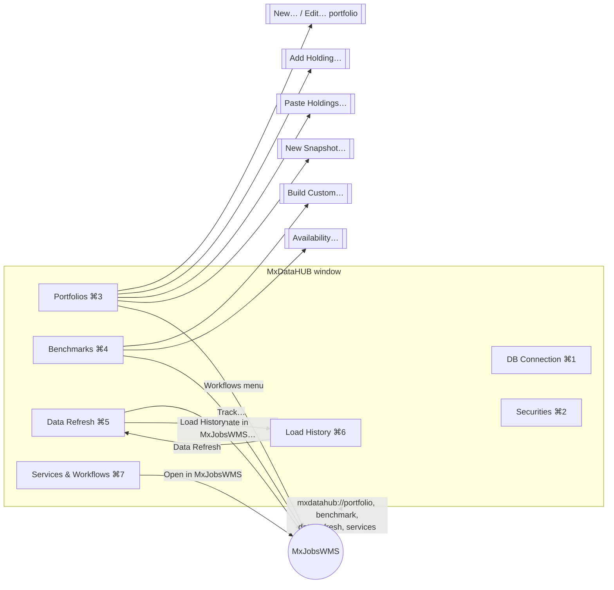

# UI screen catalog — MxDataHUB

One window, **MxDataHUB** (default 1560 × 900, minimum 1360 × 720): a sidebar of seven screens, the selected screen,
and a status bar. Quick Help (⌥⌘/) docks at the bottom of the sidebar or floats.

## Navigation map

Screens that need the database show **Not Connected** (with *DB Connection…*) or **No Security Master Here**
(database without schema `srm`) instead of their content. DB Connection, Data Refresh and Services & Workflows work
without a connection.

## Global elements

| Element | Contents and behaviour |
|---|---|
| **Sidebar** | The seven screens with icons; hovering explains each in Quick Help. |
| **Hub menu** | ⌘1–⌘7 for the screens; **Connect / Reconnect** (⇧⌘K); **Disconnect**. |
| **View menu** | **Quick Help** (⌥⌘/), **Float / Dock Quick Help**. |
| **Toolbar** | While connected: **Database** drop-down — reconnects to another database on the same server with the same user and password (falls back to the previous one on failure). |
| **Status bar** | Server, database, PostgreSQL version, whether `srm` is present, the last action's message. |
| **Alerts** | Errors from any action ("MxDataHUB" alert). |

## Screens

### 1 · DB Connection

| | |
|---|---|
| **Purpose** | Point the app at the PostgreSQL server and database that hold the security master. |
| **Layout** | Form *PostgreSQL Connection*: Host, Port, User, Database, Password, **SSL** (`disable` / `prefer` / `require`), **Save password in Keychain**; **Connect / Reconnect** and **Disconnect**; status line *Connected — PostgreSQL x.y*. |
| **Actions** | Connect (⇧⌘K, Return): connects, saves the fields, stores the password if chosen, lists the server's databases, checks `to_regclass('srm.security')`, loads security types, benchmarks and portfolios. |
| **Data** | `UserDefaults` (fields), Keychain (password), PostgreSQL `pg_database`, `srm.security_type`. |
| **States** | Disconnected · Connecting · Connected · Failed (message). |

### 2 · Securities

| | |
|---|---|
| **Purpose** | Find a security by name or any identifier and see everything known about it. |
| **Layout** | Search field (*Name, ticker, ISIN, CUSIP, SEDOL, FIGI, CIK or LEI*), **Search**, filters **Type** (All types / …), **In** (Any benchmark / a benchmark / Not in any loaded benchmark), **Active only**; results table; detail panel on the right. |
| **Detail panel** | Price chart; every identifier with validity dates and source; issuer (LEI, CIK, SIC, incorporation); listings (MIC, exchange, ticker); sector / industry; market data; benchmark memberships and weights; corporate actions (latest 40). |
| **Data** | `srm.resolve_identifier`, `v_security`, `security_identifier`, `listing`, `exchange`, `issuer`, `security_classification`, `security_market_data`, `price` / `last_price`, `benchmark_weights`, `corporate_action`. |
| **Limits** | Up to 1,000 results (*truncated* note beyond). |

### 3 · Portfolios

| | |
|---|---|
| **Purpose** | Keep portfolios and their dated holdings; check them; compare with the benchmark; hand them to workflows. |
| **Layout** | Portfolio list with **New…**, **Edit…**, **Delete…**; **Holdings on** (snapshot date) with **New Snapshot…**; holdings table with **Add Holding…**, **Paste Holdings…**, **Remove**, **Copy Benchmark**, **Normalize Weights**; validation box; **vs Benchmark** (portfolio, benchmark and active weights, active share); **Workflows** menu (*Optimize — active vs B*, *Track B — passive*, *Attribution vs B*). |
| **Dialogs** | **New / Edit Portfolio**: Code, Name, Description, Base currency, Benchmark. **New Snapshot**: date (copies the latest earlier snapshot). **Add Holding**: Identifier (live *Matches* as you type), Identifier type (Auto, …), Enter Shares or Weight %. **Paste Holdings**: one `identifier [type] shares\|weight%` per line; reports lines that failed. Delete asks for confirmation. |
| **Data** | `portfolio`, `portfolio_holding`, `srm.add_holding`, `benchmark_weights`, `portfolio_valuation`, `portfolio_validate`, `portfolio_active_weights`, `resolve_identifier`. |
| **Validation shown** | Weights add up to 100 %; every holding priced, and recently; inactive securities; short positions. *Valid: weights add up and every holding is priced.* |
| **Hand-off** | Workflows → `mxjobswms://sample/{active-optimization\|passive-tracking\|attribution}?portfolio=CODE&benchmark=CODE`. |

### 4 · Benchmarks

| | |
|---|---|
| **Purpose** | Inspect benchmark members and weights; build custom benchmarks; see what can be built. |
| **Layout** | Benchmark list (method, members, *PROXY* when ETF-based); constituents table with filter; weights by sector; index level chart; **Build Custom…**, **Availability…**, **Delete…**, **Track…**. |
| **Dialogs** | **Build Custom Benchmark**: Code, Name, *Members of* (parent benchmark), **Weighting** (Equal weight / Market cap), **Sector** (All sectors / one). **Benchmark availability**: *Can be built* / *Cannot be built*, with reasons (licensing, plans). |
| **Data** | `benchmark`, `v_benchmark_summary`, `benchmark_weights`, `classification_node`, `benchmark_level`, `srm.build_benchmark`. |
| **Hand-off** | Track… → `mxjobswms://sample/passive-tracking?benchmark=CODE`. |

### 5 · Data Refresh

| | |
|---|---|
| **Purpose** | See how fresh each category of market data is and refresh it. |
| **Layout** | Header *Market data in the security master*, **Refresh All**, **Preview only (dry run)**, **Automate in MxJobsWMS…**, **Load History**; one row per category in dependency order (*later categories use the earlier ones*) with state badge, *Data as of*, *Last load*, cadence, loaders and **Refresh**; panel *This session's refreshes* with each loader's status, seconds and totals. |
| **Categories** | Reference data · Listed universe & issuers · Benchmark constituents · Identifiers & issuer data · Prices & index levels · Corporate actions · Portfolio snapshots (*Optional*). |
| **States** | fresh · due · stale · failed (badge colours); **SRM Loader Service Not Running** with *Check Again* when 127.0.0.1:8770 does not answer. |
| **Data** | srm-loader `GET /categories`, `POST /refresh/{id}` (`X-SRM-Dry-Run: 1` for preview). |
| **Hand-off** | Automate in MxJobsWMS… → `mxjobswms://sample/srm-daily-refresh`. |

### 6 · Load History

| | |
|---|---|
| **Purpose** | Audit: coverage, sources, history of snapshots and loads. |
| **Layout** | **Identifier coverage** (per identifier type, % of securities); **Sources** (plan limits); **Snapshot history** (per benchmark and portfolio: count, first and last date, months, longest gap); **Loads** (`srm.load_run`: loader, status, counts, API calls, message); **Refresh**, **Data Refresh**. |
| **States** | *Needs migration V010 (SRM/srm.py migrate)* when snapshot history is unavailable. |
| **Data** | `v_identifier_coverage`, `data_source`, `v_snapshot_coverage`, `v_load_history`, `load_run`. |

### 7 · Services & Workflows

| | |
|---|---|
| **Purpose** | Show the Layer 3 services and the MxJobsWMS workflows built on them; open a workflow for the selected portfolio. |
| **Layout** | Segmented **Workflows** / **Layer 3 Services**. *Workflows*: the five samples with the services each needs and whether they run; **Open in MxJobsWMS**. *Layer 3 Services*: each service's state, language and why, use cases, endpoints, start command, project folder (*Show Project in Finder*), and *Choosing a language*. |
| **Data** | `ServiceCatalog` (built in) and `GET /health` per service. |
| **Hand-off** | Open in MxJobsWMS → `mxjobswms://sample/<id>?portfolio=&benchmark=` (portfolio selected in Portfolios, else DEMO_GROWTH). |

## Launch arguments (testing)

`-autoConnect YES`, `-section "Data Refresh"`, `-servicesTab Services`, `-query AAPL`, `-host`, `-port`, `-user`,
`-database`, `-sslMode`; Debug builds read `PGPASSWORD`.
