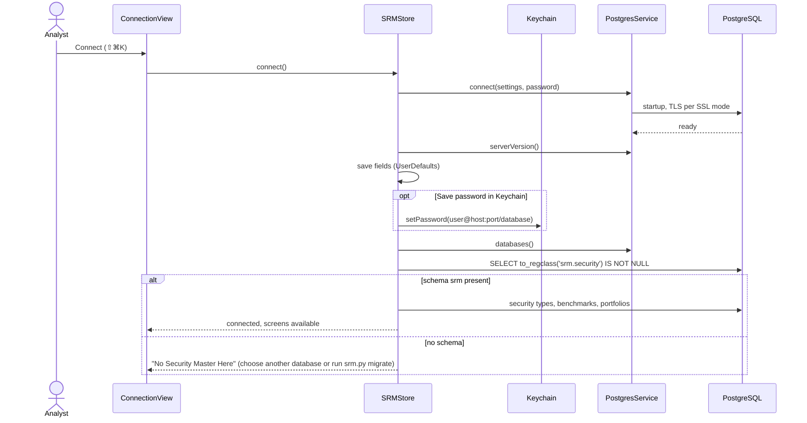
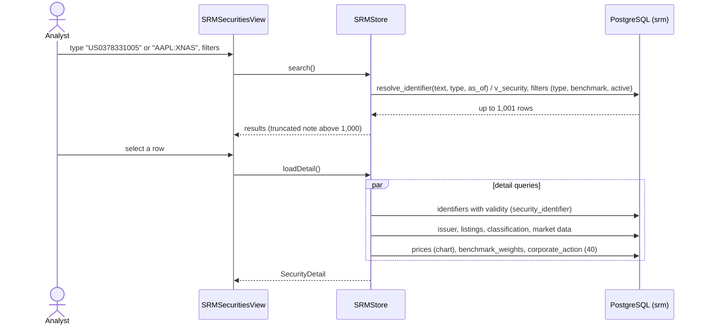
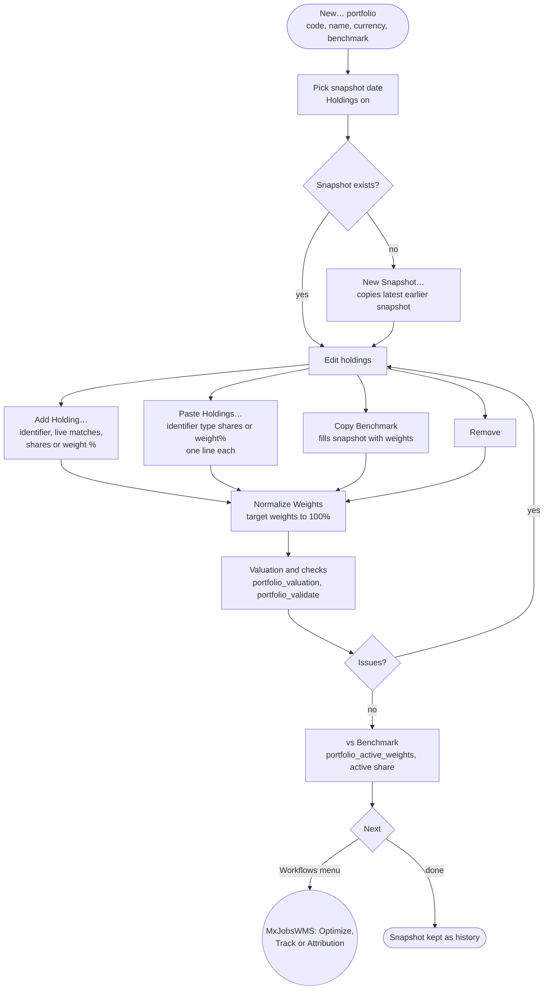
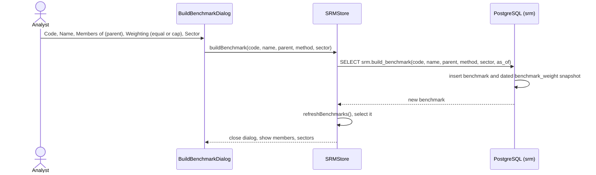
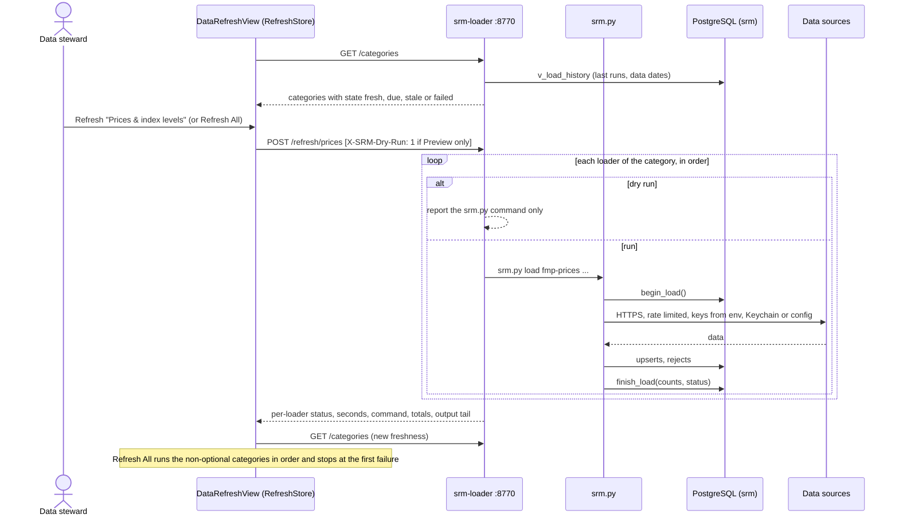
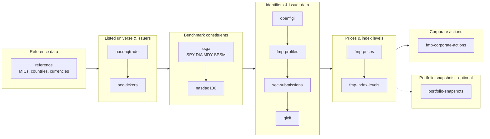
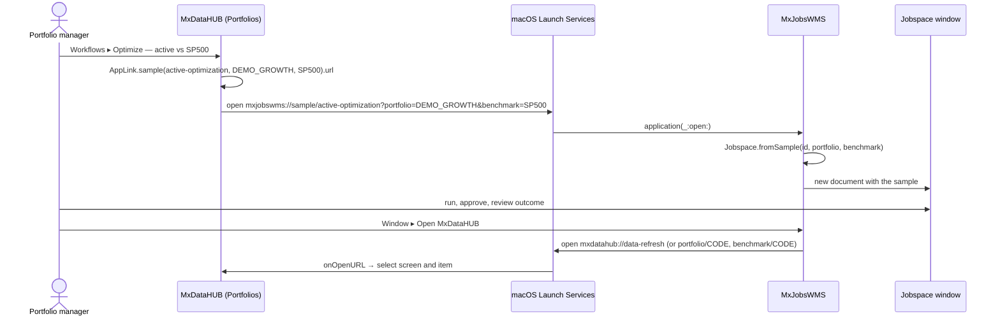
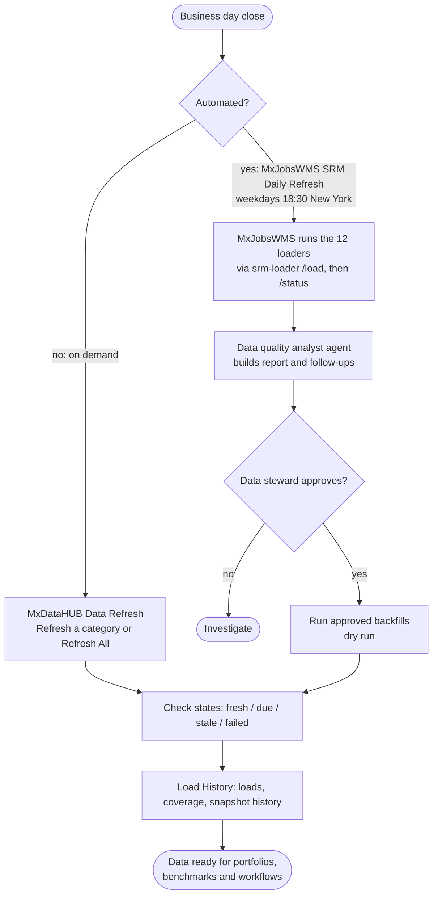
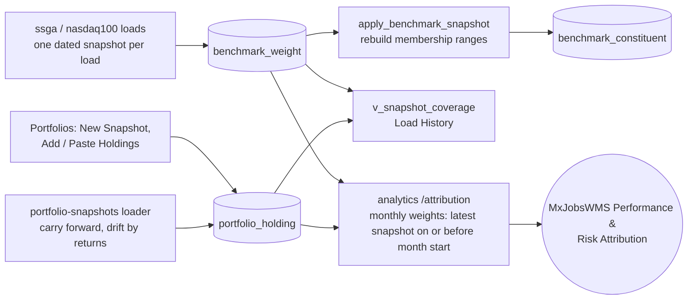

# Workflows — MxDataHUB

User and data workflows, from what the code does. Sequence diagrams name the real components, endpoints and SQL
objects.

1. [Connect and check the security master](#1-connect-and-check-the-security-master)
2. [Look up a security](#2-look-up-a-security)
3. [Maintain a portfolio](#3-maintain-a-portfolio)
4. [Build a custom benchmark](#4-build-a-custom-benchmark)
5. [Refresh a data category](#5-refresh-a-data-category)
6. [Loader dependency order](#6-loader-dependency-order)
7. [Hand a portfolio to MxJobsWMS and back](#7-hand-a-portfolio-to-mxjobswms-and-back)
8. [Daily data operations](#8-daily-data-operations)
9. [Weight history for attribution](#9-weight-history-for-attribution)

## 1. Connect and check the security master

Switching the toolbar **Database** reconnects with the same user and password; on failure it reconnects to the
previous database and shows the error.

## 2. Look up a security

## 3. Maintain a portfolio

Each box that changes data is **one SQL statement** (`INSERT`/`UPDATE`/`DELETE` or `srm.add_holding`); *Paste
Holdings* runs `add_holding` per line and lists the lines that failed.

## 4. Build a custom benchmark

## 5. Refresh a data category

When the service does not answer, the screen shows **SRM Loader Service Not Running** with the start command and
*Check Again*.

## 6. Loader dependency order

`srm.py load all` runs the same order and skips `portfolio-snapshots`.

## 7. Hand a portfolio to MxJobsWMS and back

## 8. Daily data operations

## 9. Weight history for attribution

