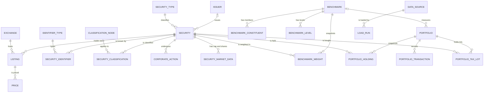
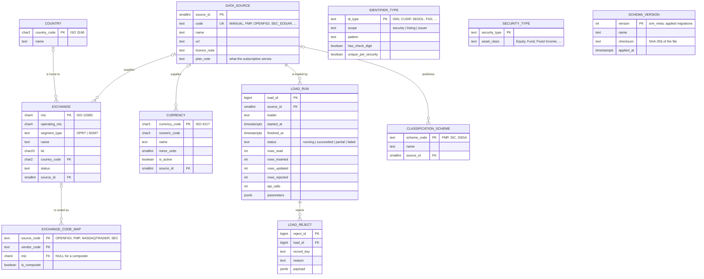
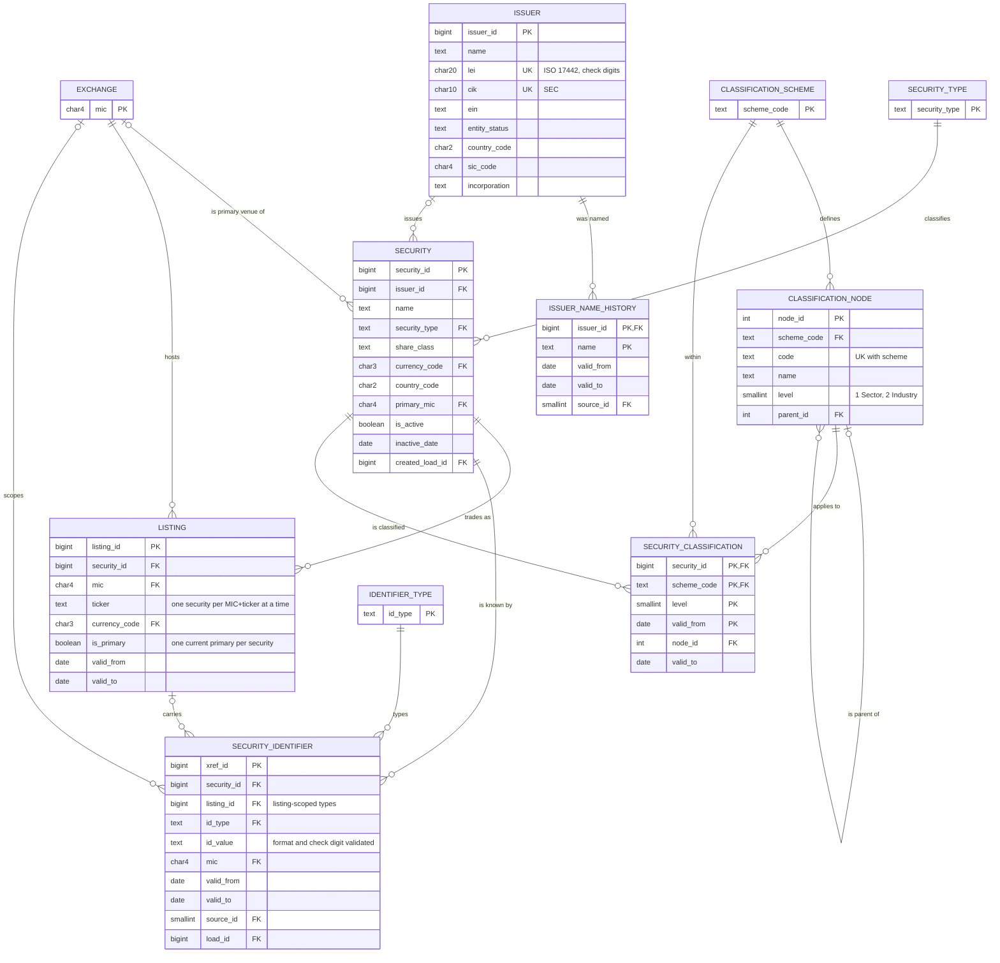
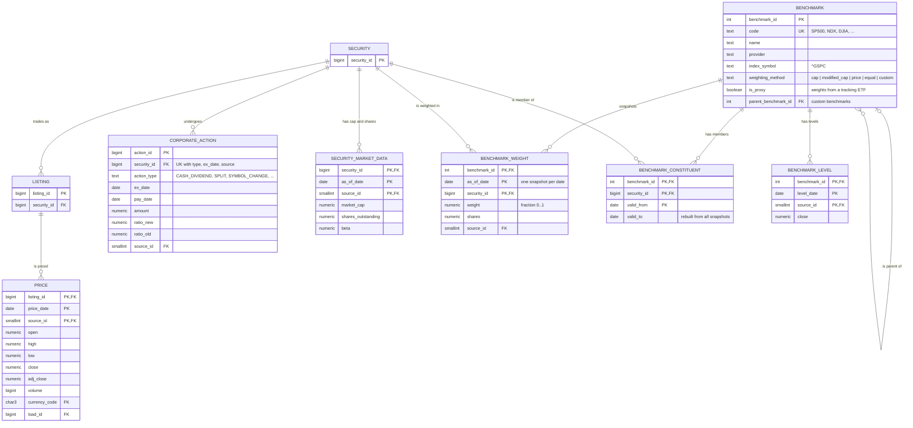
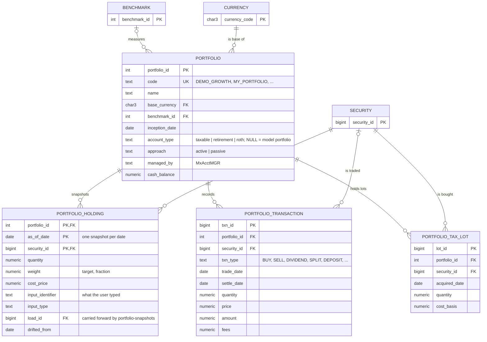

# MxDataHUB — Entity Relationship Diagram (schema `srm`)

The security reference master as built by migrations V001–V011 (and by [`ddl/install.sql`](ddl/install.sql)).
28 tables, shown as one overview and four subject areas. Crow's-foot notation: `||` exactly one, `o|` zero or one,
`|{` one or more, `o{` zero or more. Every loaded fact also points to `data_source` (who supplied it) and, optionally,
`load_run` (which load wrote it); those audit links are drawn only in the Audit diagram to keep the others readable.

## 1. Overview

## 2. Reference data and audit trail

## 3. Issuers, securities, listings and identifiers

## 4. Market data and benchmarks

## 5. Portfolios and personal accounts

`srm.sync_holdings_from_lots` writes a personal account's holdings snapshot for a day from its open tax lots (one
row per security: total shares, average cost), so every tool that reads holdings sees personal accounts as ordinary
portfolios.

## Cross-application references

| From                                                      | To                                          | How                                                           |
| ----------------------------------------------------------- | --------------------------------------------- | --------------------------------------------------------------- |
| MxAcctMGR `pmg.account.srm_code`                          | `srm.portfolio.code`                        | by code (no FK; `pmg` installs without `srm`)                 |
| MxAcctMGR `pmg.security.srm_security_id`                  | `srm.security.security_id`                  | cached copy of a security-master security                     |
| MxJobsMGR `wms.job_run.portfolio_code` / `benchmark_code` | `srm.portfolio.code` / `srm.benchmark.code` | by code, from `mxjobsmgr://sample/<id>?portfolio=&benchmark=` |
| accounts service (8774)                                   | `srm.portfolio`, `srm.portfolio_tax_lot`    | writes MxAcctMGR's My Portfolio                               |
