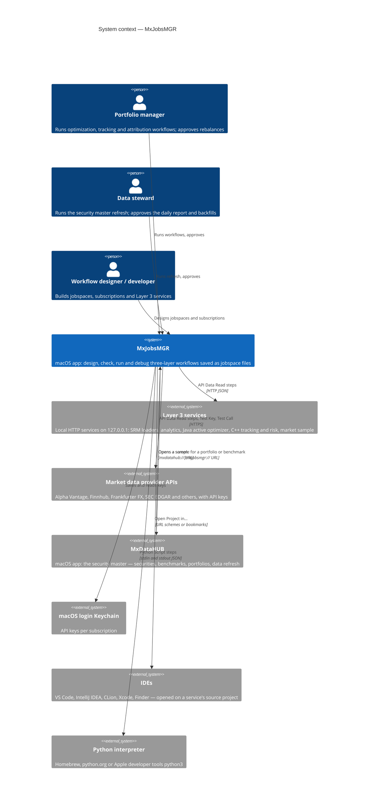

# 01 · System context (C4 level 1)

MxJobsMGR turns a desk's recurring processes — refreshing the security master, active optimization, passive index
tracking, attribution, market-data gathering — into **jobspaces**: diagrams that can be checked, rehearsed, run
step by step, and approved by a person before anything is executed.

## Actors

| Actor | Goals in MxJobsMGR |
|---|---|
| **Portfolio manager** | Open the Active, Passive or Attribution sample for a portfolio (often from MxDataHUB), run it, review the optimizer's or tracker's outcome and the decision, approve or reject the instructions, see the outcome report. |
| **Data steward** | Run the SRM Daily Refresh (mock, preview or live), review the data-quality report, approve backfills. |
| **Workflow designer / developer** | Build jobspaces from the palette; configure API subscriptions and keys; write Python steps; wire Layer 3 services (Add Step); check Problems; debug with breakpoints and Step; export diagrams; open the service's project in the IDE. |

## External systems

| System | Relationship | Notes |
|---|---|---|
| **Layer 3 services** | Called by API Data Read steps through **Local service** subscriptions; their state, purpose and endpoints shown in Layer 3 Services. | 127.0.0.1 only, outside the sandbox; started with `Services/mxservices.py`. Outcomes carry a `decisionContext` for Layer 2. |
| **Provider APIs** | Called by API Data Read steps with the subscription's key (query parameter, header, bearer). | Keys in the Keychain, never in the jobspace. Rate limits noted per subscription. |
| **MxDataHUB** | Peer app; hand-offs both ways by URL scheme. | [ADR-0012](adr/0012-data-and-process-apps-linked-by-url-schemes.md). |
| **Login Keychain** | API keys per subscription (`com.k3jdr.MxJobsMGR`, account `subscription-<id>`). | |
| **Python interpreter** | Runs Python Script steps inside the app's sandbox. | The run asks once before the first script. |
| **IDEs** | *Open Project in…* for a subscription's source folder. | VS Code and IntelliJ by URL scheme; CLion, Xcode and Finder through a security-scoped bookmark. |

## Scope

In scope: designing, validating, rehearsing, running and debugging workflows; approvals and confirmations; key
management; diagram export. Not yet in scope (by design, see [ADR-0006](adr/0006-execution-requests-never-send-yet.md)):
sending execution requests to order-management or other targets, real LLM agents (agents are simulated), unattended
scheduling (triggers record their schedule; runs start from the app).
