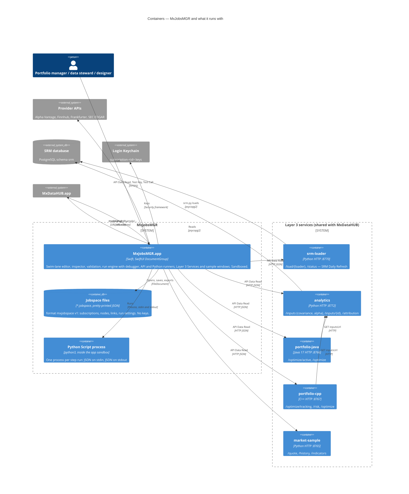

# 02 · Containers (C4 level 2)

## Containers

| Container | Technology | Responsibility | Owns |
|---|---|---|---|
| **MxJobsMGR.app** | Swift 5 mode, SwiftUI `DocumentGroup`, Observation; no third-party packages | Each window edits one jobspace: palette, swim-lane canvas, inspector, run bar and console; validation (*Problems*); runs and debugs; manages subscriptions and keys; exports PNG and draw.io SVG; Layer 3 Services, New from Sample and Adding API Keys windows. | Window and editor state; bookmarks for project folders (`UserDefaults`) |
| **Jobspace files** | JSON (`format: "mxjobspace"`, `formatVersion: 1`), UTType `com.k3jdr.mxjobsmgr.jobspace` | The workflow definition: subscriptions (without keys), nodes with kind-specific settings, links, run settings. Missing keys decode to defaults, so older files keep opening; plain `.json` files open too. | Everything except secrets and run results |
| **Python Script process** | `python3` from the step's path, else Homebrew, python.org or Apple's developer tools (mapped past the `xcrun` shim) | Runs a step's code: stdin `{"arguments","inputs","step"}`, stdout = the step's output (JSON); env `MXJOBS_API_KEY`, `MXJOBS_BASE_URL`. | Nothing; runs in the app's sandbox |
| **Layer 3 services** | Python, Java, C++ HTTP on 127.0.0.1 | Data reads and computations the steps call; each outcome includes a `decisionContext` (recommendation, confidence, alternatives, reason). | Their computations; large matrices stay inside (`inputsUrl`) |

## Interfaces

| From → to | Interface | Details |
|---|---|---|
| App ↔ jobspace file | `FileDocument` (`JobspaceDocument`) | Pretty-printed, sorted keys; reads `.jobspace` and `.json`, writes `.jobspace`. |
| App → services and providers | HTTP(S) via `URLSession` (`ApiTester`) | Method, base URL + path, query parameters, headers, JSON body; values may use `{{argument}}`, `{{today}}`, `{{yesterday}}`, `{{in:output.path}}`, `{{json:output.path}}`. Auth per subscription: none, query parameter, header, bearer, local service (bearer only when a token is stored). Checks: success status, required JSON fields, value checks (`path op value`). |
| Layer 3 contracts | JSON, versioned (`mxjobs.optimization/1`, `mxjobs.risk/1`, `mxjobs.inputs/1`, `mxjobs.active-optimization/1`, `mxjobs.tracking/1`, `mxjobs.attribution/1`) | Defined in `Services/contracts`; a breaking change gets `/2` served alongside `/1`. |
| App → Python | `Process` | JSON on stdin and stdout; exit code 0 expected; timeout and exception policy of the step apply. |
| App → Keychain | Security framework | Service `com.k3jdr.MxJobsMGR`, account `subscription-<uuid>`; `KeychainChanges` revision redraws key status. |
| App ↔ MxDataHUB | URL schemes | `mxjobsmgr://sample/<id>?portfolio=&benchmark=` in; `mxdatahub://…` out (`Shared/AppLinks.swift`). |
| App → IDEs | `vscode://file/<path>/`, IntelliJ's URL scheme; CLion, Xcode, Finder via `NSWorkspace` with a security-scoped bookmark | *Open Project in…* on a subscription's Source Project. |
