# 03 · Components of MxJobsMGR.app (C4 level 3)

A `DocumentGroup` app: each window owns one `JobspaceDocument` and one `EditorState` (selection, zoom, panels and
a `RunEngine`). Menu commands reach the front window through `FocusedValues` (`\.editor`).

```mermaid
C4Component
    title Components — MxJobsMGR.app

    Container_Boundary(app, "MxJobsMGR.app") {
        Component(shell, "App and commands", "MxJobsMGRApp, JobspaceCommands, AppDelegate", "Document windows; New from Sample, Export, Run and Diagram menus; Layer 3 Services, New from Sample, Adding API Keys windows; mxjobsmgr:// links")
        Component(editor, "Editor window", "ContentView, EditorState", "Palette, run bar, canvas, console, inspector, toolbar; selection, zoom, panels; focused editor for commands")
        Component(canvas, "Swim-lane canvas", "DiagramCanvas, NodeView, LanesView", "Three lanes; drag, link handle, rubber-band, nudge, zoom; run state on each node; context menu export")
        Component(palette, "Palette", "PaletteView", "Node kinds by layer; Layer 3 services with state; double-click or drag to add")
        Component(inspector, "Inspector", "InspectorView sections", "Node: kind settings, Arguments, Expected Outcome, Exception Handling, Last Run, Test Call, Run Script. Link. Jobspace.")
        Component(subs, "API Subscriptions", "SubscriptionsDialog, KeyHelp", "Subscription fields, auth style, headers, Source Project; Save / Test / Remove Key; provider key guides")
        Component(validator, "Validator", "Validation.swift", "Problems: approvals before execution, subscriptions, keys, paths, Python, links, base URLs")
        Component(engine, "Run engine", "RunEngine, RunViews", "Orders steps across layers; per-layer actions; breakpoints, Step, Pause, Stop; prompts; exception policies; log and outputs")
        Component(api, "API runner", "ApiTester", "Builds requests with substitutions and auth, sends them, checks expected outcome; Test Key, Test Call")
        Component(python, "Python runner", "PythonRunner", "Finds an interpreter, runs code with JSON stdin and stdout, timeout")
        Component(model, "Jobspace model", "JobspaceModel, JobspaceDocument", "Codable model with defaults for missing keys; editing operations; file I/O")
        Component(samples, "Samples", "SampleLibrary, SampleJobspace, SRMSampleJobspace, PortfolioSamples", "Build the five sample jobspaces in code, for a portfolio and benchmark")
        Component(export, "Diagram export", "DiagramExport", "PNG at 2x; draw.io SVG with embedded draw.io XML")
        Component(projects, "Project opener", "ProjectOpener", "Open a subscription's source folder in VS Code, IntelliJ, CLion, Xcode or Finder; security-scoped bookmarks")
        Component(keychain, "Keychain", "Keychain, KeychainChanges", "Key per subscription; observable revision")
        Component(help, "JobsQuickHelp", "QuickHelp items", "Quick Help text for steps, lanes, handles, run bar, console, inspector, subscriptions")
        Component(shared, "Shared (../Shared)", "AppLinks, ServiceCatalog, ServicesView, QuickHelp", "Hand-off URLs, service and sample catalog, services and samples views, Quick Help panel")
    }

    ContainerDb(doc, "Jobspace files", "JSON")
    Container(services, "Layer 3 services", "HTTP 127.0.0.1")
    System_Ext(providers, "Provider APIs")
    Container(py, "python3 process")
    System_Ext(kc, "Login Keychain")

    Rel(shell, editor, "One per document window")
    Rel(editor, canvas, "Hosts")
    Rel(editor, palette, "Hosts")
    Rel(editor, inspector, "Hosts")
    Rel(editor, engine, "Owns one")
    Rel(editor, validator, "Checks on every change")
    Rel(canvas, model, "Edits nodes and links")
    Rel(inspector, model, "Edits settings")
    Rel(inspector, api, "Test Call")
    Rel(inspector, python, "Run Script")
    Rel(engine, api, "API Data Read steps")
    Rel(engine, python, "Python Script steps")
    Rel(api, services, "HTTP")
    Rel(api, providers, "HTTPS")
    Rel(api, keychain, "Key for the subscription")
    Rel(python, py, "Process")
    Rel(keychain, kc, "SecItem API")
    Rel(subs, keychain, "Save / Remove Key")
    Rel(model, doc, "Read / write")
    Rel(shell, samples, "New from Sample, links")
    Rel(shell, shared, "ServicesView, SampleGalleryView, AppLink")
    Rel(canvas, export, "Save as PNG or draw.io SVG")
    Rel(inspector, projects, "Open Project in…")

    UpdateLayoutConfig($c4ShapeInRow="4", $c4BoundaryInRow="1")
```

## Components

| Component             | Files                                                                        | Responsibility                                                                                                                                                                                                                                                                                                                                                                                                                                                                                                                                                                                                                                                                                        |
| ----------------------- | ------------------------------------------------------------------------------ | ------------------------------------------------------------------------------------------------------------------------------------------------------------------------------------------------------------------------------------------------------------------------------------------------------------------------------------------------------------------------------------------------------------------------------------------------------------------------------------------------------------------------------------------------------------------------------------------------------------------------------------------------------------------------------------------------------- |
| **App and commands**  | `MxJobsMGRApp.swift`, `SampleLibrary.swift` (`PendingSample`, `AppDelegate`) | `DocumentGroup(newDocument:)` — a new window is empty or takes the sample `PendingSample` hands over. Windows *Adding API Keys*, *Layer 3 Services* (⌥⌘L), *New from Sample* (⌥⌘N). Menus: File ▸ New from Sample / New Sample / Export Diagram; Edit ▸ Duplicate, Delete, Select All Nodes; **Run** (Run/Continue ⌘R, Continue ⌃⌘Y, Step F6, Pause, Stop ⌘., Toggle Breakpoint ⌘\, (De)activate Breakpoints ⌘Y, Run Console ⇧⌘Y, Clear Run Results); **Diagram** (Add Node, zoom, Problems ⇧⌘K, API Subscriptions ⌥⌘K, Inspector ⌥⌘I); Window ▸ Layer 3 Services, Open MxDataHUB; Help ▸ Adding API Keys. `AppDelegate.application(_:open:)` handles `mxjobsmgr://sample/…`. |
| **Editor window**     | `ContentView.swift`, `EditorState.swift`                                     | `NavigationSplitView`: palette (with Quick Help dock) │ run bar, canvas, run console │ inspector. Toolbar: zoom, Problems popover, API Subscriptions, Inspector. `EditorState` keeps selection, zoom (40–200 %), panel visibility, console height, the `RunEngine`, and `lastActive` (front editor for the Services window's *Add Step*). Layout metrics: lanes 240 pt, nodes 190 × 78, 10-pt grid.                                                                                                                                                                                                                                                                                               |
| **Swim-lane canvas**  | `DiagramCanvas.swift`, `NodeView.swift`                                      | Draws the three lanes, links (down = call, up = result, dashed), nodes with run state and breakpoint tag; keeps each node in its lane; ● handle to link; rubber-band and ⇧-click selection; arrow-key nudge (⇧ = 100 pt); pinch zoom; right-click *Save as PNG…*, *Save as draw.io SVG…*, Step, Stop, Duplicate, Delete.                                                                                                                                                                                                                                                                                                                                                                         |
| **Palette**           | `PaletteView.swift`                                                          | Node kinds by layer (drag or double-click to add); **Layer 3 Services** with live state (double-click adds a step, right-click picks an endpoint, *About…*); *New from Sample…*, *Layer 3 Services…*.                                                                                                                                                                                                                                                                                                                                                                                                                                                                                              |
| **Inspector**         | `InspectorView.swift`                                                        | `NodeInspector`: title, notes, enabled, breakpoint; kind sections (Schedule, Agent, Approval, Execution Request, Outcome Report, API with Query Parameters / Headers / Body, Script, Transform); **Arguments**; **Expected Outcome** with value checks; **Exception Handling**; **Last Run**; *Test Call*, *Run Script*, *Open Project in…*, *About This Service*. `LinkInspector`: label. `JobspaceInspector`: name, description, layer counts, subscriptions, checks.                                                                                                                                                                                                                              |
| **API Subscriptions** | `SubscriptionsDialog.swift`, `KeyHelp.swift`                                 | Sheet: list with *New Subscription* / *Local Python Service*; Service (name, provider, base URL, plan, rate limit, documentation), **Authentication** (none, query parameter, header, bearer, local service), headers, Notes, **API Key** (*Paste & Save*, *Save Key* → Test Key, *Remove Key*), Source Project (*Choose…*, *Open with*). `KeysHelpView` / `KeyGuideView`: provider-specific steps and *Get a Key…*.                                                                                                                                                                                                                                                                               |
| **Validator**         | `Validation.swift`                                                           | `Validator.check(space)` → errors, warnings, info; shown on the toolbar, in the Problems popover and on nodes.                                                                                                                                                                                                                                                                                                                                                                                                                                                                                                                                                                                       |
| **Run engine**        | `RunEngine.swift`, `RunViews.swift`                                          | See [04 · Code](04-code.md) and [Workflows](workflows.md). `RunBar` (Run/Continue, Pause, Step, Stop, L1/L2/L3 menus, Breakpoints, Options), `RunPromptBanner`, `RunConsole` (log filter, output JSON).                                                                                                                                                                                                                                                                                                                                                                                                                                                                                              |
| **API runner**        | `ApiTester.swift`                                                            | `substitute` (`{{arg}}`, `{{today}}`, `{{yesterday}}`), `fillInputs` (`{{in:…}}`, `{{json:…}}`), `buildRequest` with auth style, send, check status / required fields / value checks; *Test Key* per provider; masks keys in URLs shown.                                                                                                                                                                                                                                                                                                                                                                                                                                                            |
| **Python runner**     | `PythonRunner.swift`                                                         | Interpreter: step's path, else Homebrew, python.org, developer tools (`/usr/bin/python3` mapped to the real binary). stdin request, stdout JSON, env with the subscription's key and base URL, timeout.                                                                                                                                                                                                                                                                                                                                                                                                                                                                                               |
| **Jobspace model**    | `JobspaceModel.swift`, `JobspaceDocument.swift`                              | `Jobspace` (format, version, name, description, subscriptions, nodes, links, run); `JobNode` with kind-specific specs; `JobLink`; `ApiSubscription`; `RunSettings`; tolerant decoding with defaults; `addLink`, `delete`, `duplicate`.                                                                                                                                                                                                                                                                                                                                                                                                                                                                |
| **Samples**           | `SampleJobspace.swift`, `SRMSampleJobspace.swift`, `PortfolioSamples.swift`  | Build the samples in code (also saved under `Samples/`), parameterised by portfolio and benchmark.                                                                                                                                                                                                                                                                                                                                                                                                                                                                                                                                                                                                    |
| **Diagram export**    | `DiagramExport.swift`                                                        | PNG (2×) and `*.drawio.svg` (SVG with draw.io XML: a swimlane per layer, connectors, dashed results).                                                                                                                                                                                                                                                                                                                                                                                                                                                                                                                                                                                                |
| **Project opener**    | `ProjectOpener.swift`                                                        | VS Code (`vscode://file/…`) and IntelliJ by URL; CLion, Xcode, Finder through a remembered security-scoped bookmark (*Choose…* / *Grant Access…*).                                                                                                                                                                                                                                                                                                                                                                                                                                                                                                                                                 |
| **Keychain**          | `Keychain.swift`                                                             | `secret(for:)`, save, delete under `com.k3jdr.MxJobsMGR` / `subscription-<id>`; `KeychainChanges.revision`.                                                                                                                                                                                                                                                                                                                                                                                                                                                                                                                                                                                           |
| **JobsQuickHelp**     | `JobsQuickHelp.swift`                                                        | Quick Help text: steps (kind, last run, problems), lanes, handles, breakpoints, run bar, console, approvals waiting, inspector sections, toolbar, subscriptions.                                                                                                                                                                                                                                                                                                                                                                                                                                                                                                                                      |
| **Shared**            | `../Shared/*`                                                                | As in MxDataHUB: `AppLink`, `ServiceCatalog` (+ health checks), `ServicesView`, `SampleGalleryView`, Quick Help panel.                                                                                                                                                                                                                                                                                                                                                                                                                                                                                                                                                                                |

## Rules

- The model types are `nonisolated`, `Codable`, `Sendable` value types; views and `EditorState`/`RunEngine` are `@MainActor`.
- Keys never enter the model: the document has subscription ids; the Keychain has the keys ([ADR-0004](adr/0004-api-keys-in-keychain-never-in-jobspace.md)).
- The engine never sends execution requests ([ADR-0006](adr/0006-execution-requests-never-send-yet.md)).
