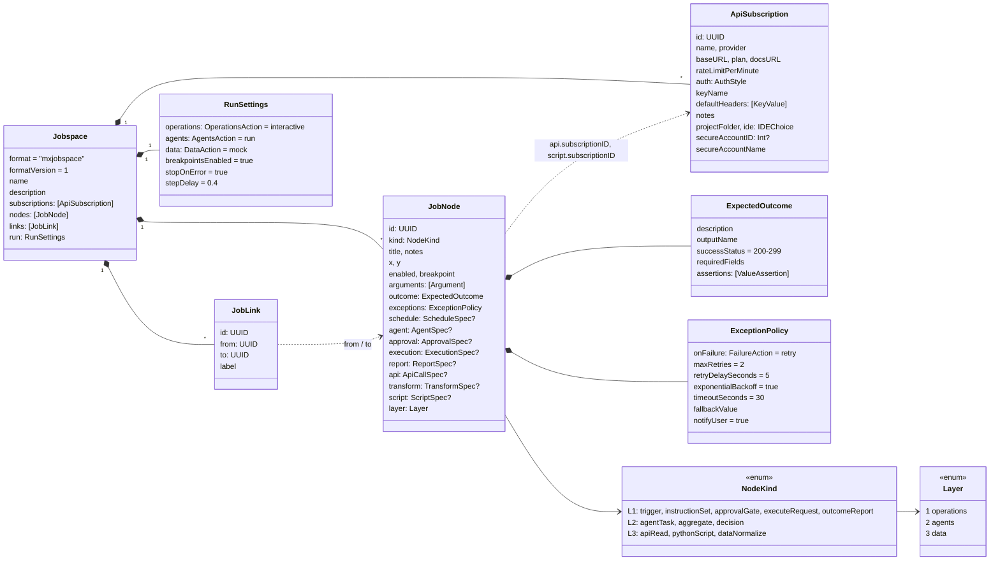
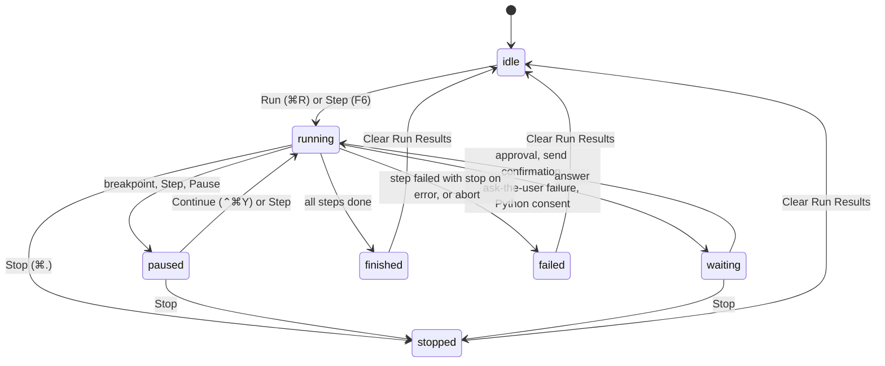
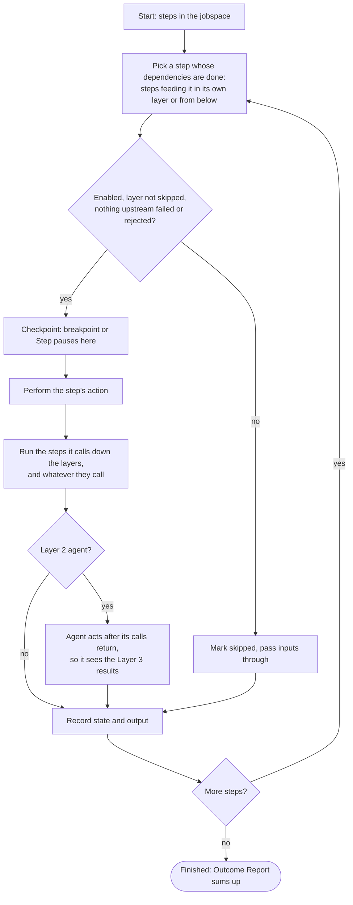

# 04 · Code and data model (C4 level 4)

## The jobspace document

A jobspace file is pretty-printed JSON with sorted keys. Every property decodes with a default when missing, links
to unknown nodes are dropped, so files from earlier versions keep opening ([ADR-0001](adr/0001-document-based-app-with-json-jobspace-files.md)).

### Enumerations

| Type | Values |
|---|---|
| `AuthStyle` | `none`, `queryParameter`, `header`, `bearer`, `localService` (bearer only when a token is stored) |
| `FailureAction` | `retry`, `skip`, `useFallback`, `escalateToUser` (Retry / Skip / Abort prompt), `abortRun` |
| `AssertionOp` | `==`, `!=`, `<`, `<=`, `>`, `>=`, `contains`, `exists` (numeric when both sides are numbers) |
| `ScheduleMode` | `manual`, `daily`, `weekdays`, `interval` (recorded; runs start from the app) |
| `ApprovalChannel` | `inApp`, `email`, `message` |
| `ExecutionMode` | `dryRun`, `paper`, `live` |
| `OperationsAction` / `AgentsAction` / `DataAction` | Interactive, Auto-approve, Skip / Run, Skip / Live, Mock, Skip |
| `IDEChoice` | `vscode`, `intellij`, `clion`, `xcode`, `finder` |
| `ArgumentType` | `text`, `number`, `date`, `symbols`, `boolean` |

### Links

A link from a higher layer to a lower one is a **call**; from lower to higher it **returns results** (drawn
dashed); within a layer it is **flow**. The Validator warns when a link skips the agent layer (1 ↔ 3).

## What each step kind does when run

| Kind | Layer | Run behaviour (`RunEngine.perform`) | Output |
|---|---|---|---|
| Refresh Trigger | 1 | Records the start time and its arguments | `startedAt`, arguments |
| Assemble Instructions | 1 | Collects its inputs with the assembly instructions | `instructions`, `assembly` |
| User Approval | 1 | Interactive: **Approve / Reject** prompt with the summary and inputs; Auto-approve: approves with a warning. Reject blocks everything after it. | `approved`, `instructions` |
| Execution Request | 1 | Optional **Send / Cancel** confirmation; **never sends** — reports target, mode and request (warning state) | `sent: false`, `mode`, `target`, `request` |
| Outcome Report | 1 | Counts step states | succeeded, warnings, failed, skipped, recipients, results |
| Agent Task, Aggregate Results | 2 | Simulated: passes its inputs on (model noted as not connected) | inputs |
| Decision | 2 | Follows the `decisionContext` of its inputs — those named in its Inputs list first, then the most confident — else **escalate** (warning) | `nextStep`, `confidence`, `source`, `alternatives`, `reason` |
| API Data Read | 3 | Live: HTTP with substitutions, auth and checks, under the exception policy; Mock: generated data that passes the checks | response JSON |
| Python Script | 3 | Live: asks once *Run Python scripts?*, then runs; Mock: generated data | stdout JSON |
| Normalize Data | 3 | Maps fields by path from its input; missing fields → exception policy | mapped fields |

## Run engine states

Each node shows its own `NodeRunState`: pending, paused, running, waiting (for you), succeeded, warning
(completed with warnings), failed, skipped.

## Scheduling algorithm

Each step runs once; cycles (a call down whose result comes back up) are allowed. Inputs of a step are the outputs
of the steps linked into it, by their *output name*.
