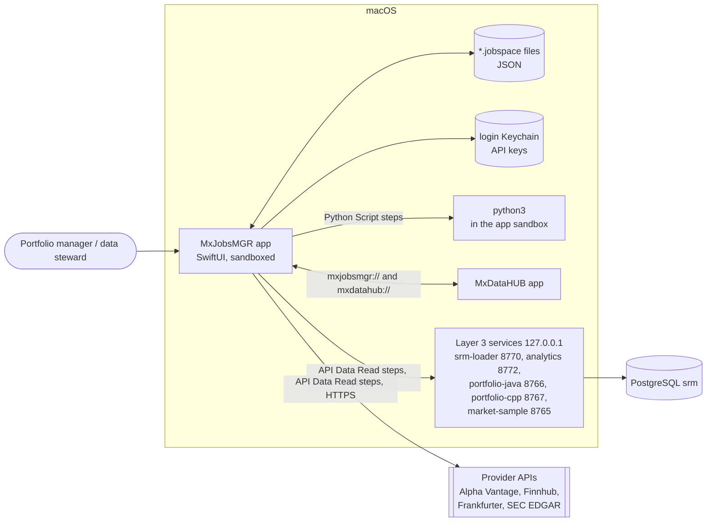

# MxJobsMGR — architecture

MxJobsMGR is a native macOS business application (Swift, SwiftUI, document-based) for designing and running the
**financial market-data and portfolio workflows** of a desk as three-layer diagrams called **jobspaces**
(`*.jobspace`, JSON). A jobspace says who triggers and approves a process (Layer 1, business operations), which
agents prepare and decide (Layer 2), and which data reads and computations run (Layer 3, API calls to subscribed
providers or local services, and Python). MxJobsMGR is **the processes** half of a pair: its sibling
[MxDataHUB](../../MxDataHUB/c4/README.md) keeps **the data** (the security master), and both use the same
**Layer 3 services**.

This folder documents the architecture with the [C4 model](https://c4model.com), Architecture Decision Records, a UI
screen catalog and workflow diagrams. Diagrams are [Mermaid](https://mermaid.js.org); [`workspace.dsl`](workspace.dsl)
holds the same C4 model for [Structurizr](https://structurizr.com).

| Document | What it covers |
|---|---|
| [01 · System context](01-system-context.md) | Who uses MxJobsMGR and which systems it reaches (C4 level 1) |
| [02 · Containers](02-containers.md) | The app, jobspace files, Layer 3 services, providers, Python (C4 level 2) |
| [03 · Components](03-components.md) | Inside the app: editor, canvas, inspector, run engine, API and Python runners (C4 level 3) |
| [04 · Code and data model](04-code.md) | The jobspace document model and the run engine's states (C4 level 4) |
| [05 · Deployment](05-deployment.md) | Where each part runs and what the sandbox allows |
| [ADRs](adr/README.md) | Architecture decisions, with context and consequences |
| [UI screen catalog](ui-screen-catalog.md) | Every window, panel, sheet and prompt |
| [Workflows](workflows.md) | Authoring, running and debugging, approvals, failures, the sample workflows, hand-offs |

## The system on one page

## Facts at a glance

| | |
|---|---|
| Platform | macOS 26.6+, Swift 5 language mode, SwiftUI `DocumentGroup`, Observation, default `MainActor` isolation |
| Bundle | `com.k3jdr.MxJobsMGR`; document type `com.k3jdr.mxjobsmgr.jobspace` (`*.jobspace`, conforms to JSON); URL scheme `mxjobsmgr://` |
| Sandbox | App Sandbox: outgoing network, user-selected files read/write, app-scope security-scoped bookmarks |
| Dependencies | None outside the SDK; `../Shared` sources compiled in |
| Size | ~7,000 lines of Swift in the app, ~1,100 shared |
| Samples | SRM Daily Refresh, Active Portfolio Optimization, Passive Index Tracking, Performance & Risk Attribution, Daily Market Data Refresh (`Samples/`) |
| Sources of truth | Code in `../MxJobsMGR/`, `../Shared/`, `../Services/`; [README](../README.md), [Services/README](../../Services/README.md), [contracts](../../Services/contracts/README.md) |

*Recorded 2026-10-17 from the code on `main` at commit `6545216`. The ADRs are written retrospectively: they
document the decisions the code embodies, not a meeting record.*
