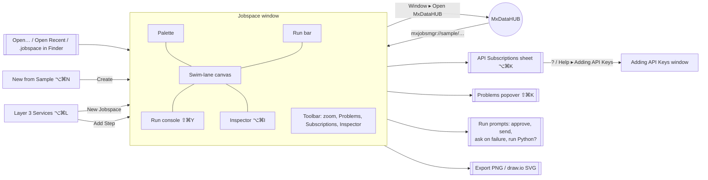

# UI screen catalog — MxJobsMGR

A document-based app: every jobspace opens in its own **jobspace window**. Three utility windows (Layer 3 Services,
New from Sample, Adding API Keys) and one sheet (API Subscriptions) complete the UI. Quick Help (⌥⌘/) docks at the
bottom of the palette or floats.

## Navigation map

## Menus

| Menu | Items |
|---|---|
| **File** | New, **New from Sample…** (⌥⌘N), **New Sample ▸** (each sample), Open, Open Recent, Save, Save As, Duplicate, Rename, Revert, **Export Diagram as PNG…**, **Export Diagram as draw.io SVG…** |
| **Edit** | Standard, plus **Duplicate Nodes** (⌘D), **Delete Selection**, **Select All Nodes** (⌥⌘A) |
| **View** | **Quick Help** (⌥⌘/), **Float / Dock Quick Help** |
| **Run** | **Run / Continue** (⌘R), **Continue** (⌃⌘Y), **Step** (F6), **Pause**, **Stop** (⌘.), **Toggle Breakpoint** (⌘\\), **Activate / Deactivate Breakpoints** (⌘Y), **Show / Hide Run Console** (⇧⌘Y), **Clear Run Results** |
| **Diagram** | **Add Node ▸** (by layer), **Zoom In** (⌘+), **Zoom Out** (⌘−), **Actual Size** (⌘0), **Show Problems** (⇧⌘K), **API Subscriptions…** (⌥⌘K), **Show / Hide Inspector** (⌥⌘I) |
| **Window** | **Layer 3 Services** (⌥⌘L), **Open MxDataHUB** |
| **Help** | **Adding API Keys**, **MxJobsMGR on GitHub** |

## Jobspace window

Default 1560 × 920. `NavigationSplitView`: palette │ run bar + canvas + console │ inspector.

### Palette (left)

| | |
|---|---|
| **Purpose** | Add steps; see Layer 3 services. |
| **Content** | Node kinds grouped by layer (*Layer 1 · Business Operations*, *Layer 2 · Agentic Operations*, *Layer 3 · Data Reads*) — drag onto the canvas or double-click (*Add to Layer N*); **Layer 3 Services** with running state — double-click adds a step, right-click *Add Step: METHOD /path*, *About …*; *New from Sample…*, *Layer 3 Services…*; Quick Help dock. |

### Run bar (top)

| Control | Behaviour |
|---|---|
| ▶ Run / Continue, ⏸ Pause, ↳ Step, ■ Stop | Start, pause, step, stop a run |
| **L1 / L2 / L3** menus | Layer 1 *Interactive / Auto-approve / Skip*; Layer 2 *Run / Skip*; Layer 3 *Live / Mock / Skip* (saved in the jobspace) |
| ▸ Breakpoints | On / off |
| ⚙ Options | *Stop the run when a step fails*, *Step delay*, *Clear Run Results* |
| Status, console toggle | What the run is doing; show / hide the console |

### Swim-lane canvas (centre)

| | |
|---|---|
| **Purpose** | Design and watch the workflow. |
| **Content** | Three lanes (indigo L1, orange L2, teal L3) with titles in a left gutter; nodes (190 × 78) showing kind, title, run state, problems, breakpoint tag; links (down = call, up = dashed result). |
| **Interactions** | Drag nodes (10-pt grid, kept in lane); drag ● handle onto a node to link; click / ⇧-click / rubber-band select; click a link to select it; Delete; arrow keys nudge (⇧ = 100 pt); ⌘D duplicate; Escape deselects; pinch or ⌘+ / ⌘− / ⌘0 zoom (40–200 %). |
| **Context menu** | *Save as PNG…*, *Save as draw.io SVG…*; on a node: Step, Stop, Duplicate, Delete, breakpoint. |
| **Overlay** | When the console is hidden, a **run prompt banner** (approval, confirmation, failure question) appears at the top. |

### Run console (bottom, ⇧⌘Y)

Resizable. Log with level filter (*Show*: debug … error), click a line to select its step, *Clear*; the selected
step's output as JSON (*Details*).

### Inspector (right, ⌥⌘I)

| Selection | Sections |
|---|---|
| **Node** | Title, Notes, Enabled, *Breakpoint — pause runs before this step*; by kind: **Schedule** (Runs: manual / daily / weekdays / interval, *Time (HH:mm)*, *Time zone*), **Agent** (*Model / engine*, instructions, inputs, *Output format*), **Approval** (*Approver*, *Ask via*, *Summary shown to the approver*, expiry), **Execution Request** (*Target*, *Mode*, *Confirm again before sending*), **Outcome Report** (*Recipients*, *Detailed report*, include failures), **API** (*Subscription*, *Method*, *Endpoint path*, Query Parameters, Headers, Body (JSON), *Test Call*, *About This Service*, *Open Project in …*), **Script** (code, *Interpreter*, subscription, *Run Script*, *Reset to Template*), **Transform** (field mappings); **Arguments** (*Add Argument*: name, type, value, required); **Expected Outcome** (*Output name*, *Success HTTP status*, required fields, **Checks** — *Add Value Check*); **Exception Handling** (*On failure*, retries, delay, *Exponential backoff*, timeout, *Fallback value*, notify); **Last Run** (state, message, *Show Output in Console*). |
| **Link** | *Label*. |
| **Nothing** | **Jobspace**: name, description, **Layers** (counts), subscriptions (*Manage API Subscriptions…*), checks (*No problems found* or the list). |

### Toolbar

Zoom out / percentage (click for 100 %) / zoom in; **Problems** (count, icon by severity; popover list — click to
jump); **API Subscriptions**; **Inspector**.

## Sheets, popovers and prompts

| UI | Opened by | Content |
|---|---|---|
| **API Subscriptions** (sheet) | ⌥⌘K, toolbar, inspector | List with **New Subscription** and *Local Python Service* preset. **Service**: Name, Provider, Base URL, Plan, rate limit, Documentation. **Authentication**: none / query parameter / header / bearer / local service (optional token), key name, headers. **API Key**: *Secure account* picker (MxAcctMGR ▸ Secure Accounts), *Service key in Secure Accounts* / *No secure account chosen* / *No service key yet*, *Test Key*, *Open in MxAcctMGR* or *New in MxAcctMGR…*, **?** provider steps, *Get a Key…*. **Source Project**: *Project folder*, *Choose…*, *Open with* (VS Code, IntelliJ IDEA, CLion, Xcode, Finder). **Notes**. *Delete Subscription* (its key stays in MxAcctMGR), *Move Keys to Secure Accounts…* (while old keys remain), *Done*. |
| **Problems** (popover) | ⇧⌘K, toolbar | Errors, warnings, info from the Validator; click to select the step or subscription. |
| **Approval prompt** | User Approval step (Interactive) | *Approve “title”?* with summary, approver, instructions — **Approve** / **Reject**. |
| **Send confirmation** | Execution Request with *Confirm again before sending* | Target and mode — **Send** / **Cancel** (nothing is sent either way). |
| **Ask on failure** | Exception policy *ask the user* | Error and partial output — **Retry** / **Skip** / **Abort**. |
| **Run Python scripts?** | First Python Script step of a Live run | Count and code of the scripts — allow or cancel. |
| **Export panels** | Export commands | Save panel for `.png` or `.drawio.svg`. |

## Utility windows

| Window | Opened by | Content |
|---|---|---|
| **Layer 3 Services** (1040 × 720) | ⌥⌘L, palette | Shared `ServicesView`: each service's state (*Check*), language and why, use cases, endpoints with **Add Step** (to the front jobspace), *Run and develop* (start command, *Show Project in Finder*), samples using it with **New Jobspace**, *Choosing a language*. |
| **New from Sample** (860 × 640) | ⌥⌘N, palette | Shared `SampleGalleryView`: the five samples with area, services needed and whether they run; **Create**. Note: portfolio samples use DEMO_GROWTH unless opened from MxDataHUB. |
| **Adding API Keys** (820 × 560) | Help menu, **?** in Subscriptions | *Overview*, *Providers* (Alpha Vantage, Finnhub, SEC EDGAR, Frankfurter, local services, others) with steps, *Get a Key…*, *Documentation*. |

## Samples (starting points)

| Sample | Opens with | Lanes (L1 / L2 / L3 steps) |
|---|---|---|
| SRM Daily Refresh | Mock | 5 / 5 / 13 (12 loaders + status) |
| Active Portfolio Optimization | Live | 5 / 2 / 3 |
| Passive Index Tracking | Live | 5 / 2 / 3 |
| Performance & Risk Attribution | Live | 5 / 2 / 3 |
| Daily Market Data Refresh (template) | Mock | 5 / 4 / 9 |
