# Workflows — MxJobsMGR

How people use the app, how a run executes, and the sample workflows as they are wired (taken from
`Samples/*.jobspace`).

1. [Design a jobspace](#1-design-a-jobspace)
2. [Add a subscription and its key](#2-add-a-subscription-and-its-key)
3. [Run and debug](#3-run-and-debug)
4. [An API Data Read step under its exception policy](#4-an-api-data-read-step-under-its-exception-policy)
5. [Approval and execution request](#5-approval-and-execution-request)
6. [A Python Script step](#6-a-python-script-step)
7. [A Decision step](#7-a-decision-step)
8. [Sample: SRM Daily Refresh](#8-sample-srm-daily-refresh)
9. [Sample: Active Portfolio Optimization](#9-sample-active-portfolio-optimization)
10. [Sample: Passive Index Tracking](#10-sample-passive-index-tracking)
11. [Sample: Performance & Risk Attribution](#11-sample-performance--risk-attribution)
12. [Open a sample from MxDataHUB](#12-open-a-sample-from-mxdatahub)

## 1. Design a jobspace

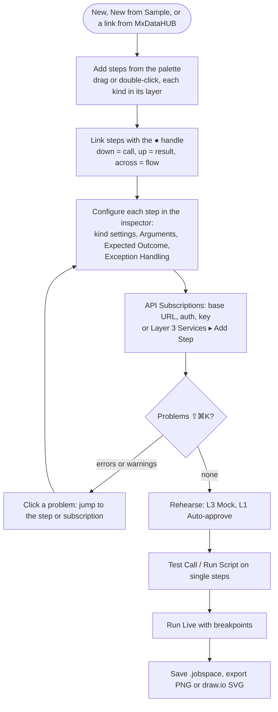

## 2. Add a subscription and its key

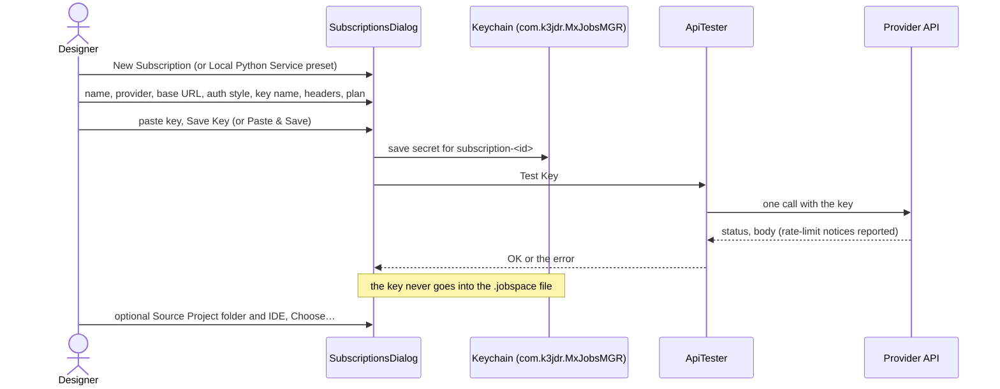

## 3. Run and debug

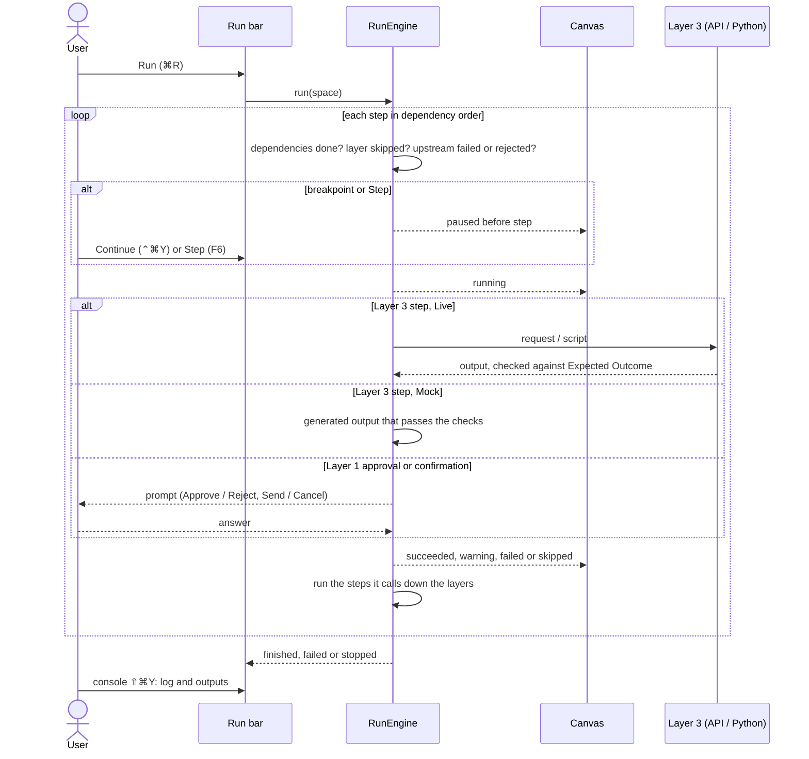

## 4. An API Data Read step under its exception policy

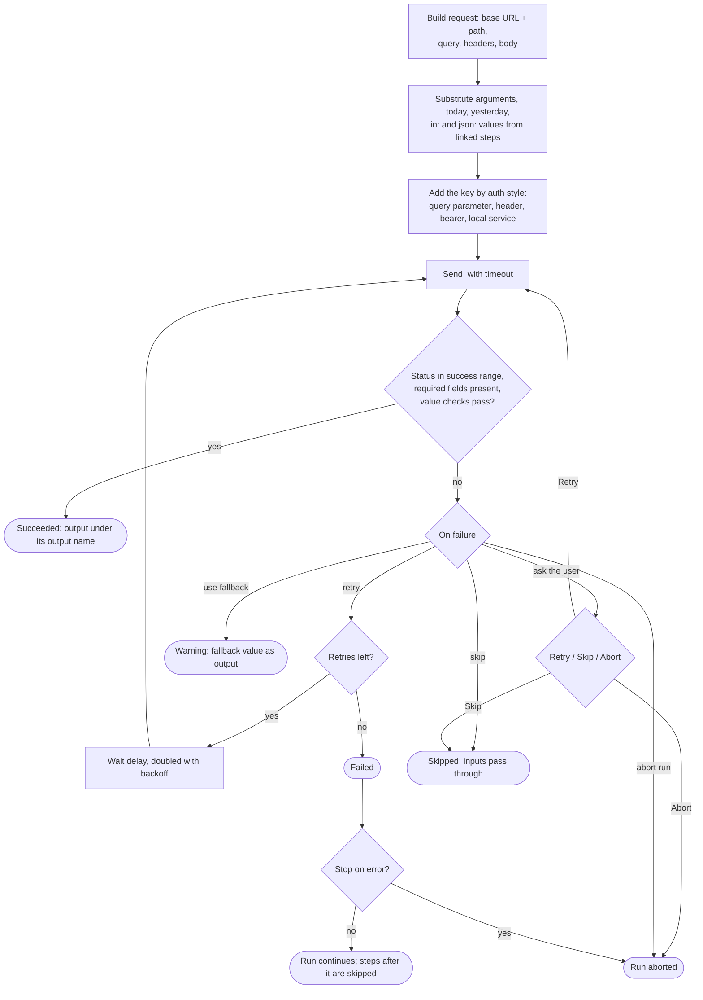

## 5. Approval and execution request

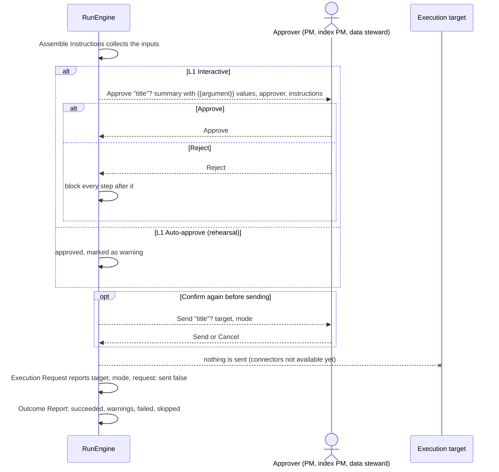

## 6. A Python Script step

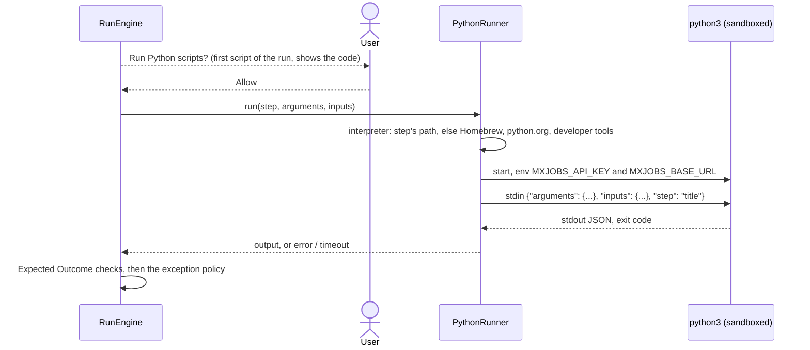

## 7. A Decision step

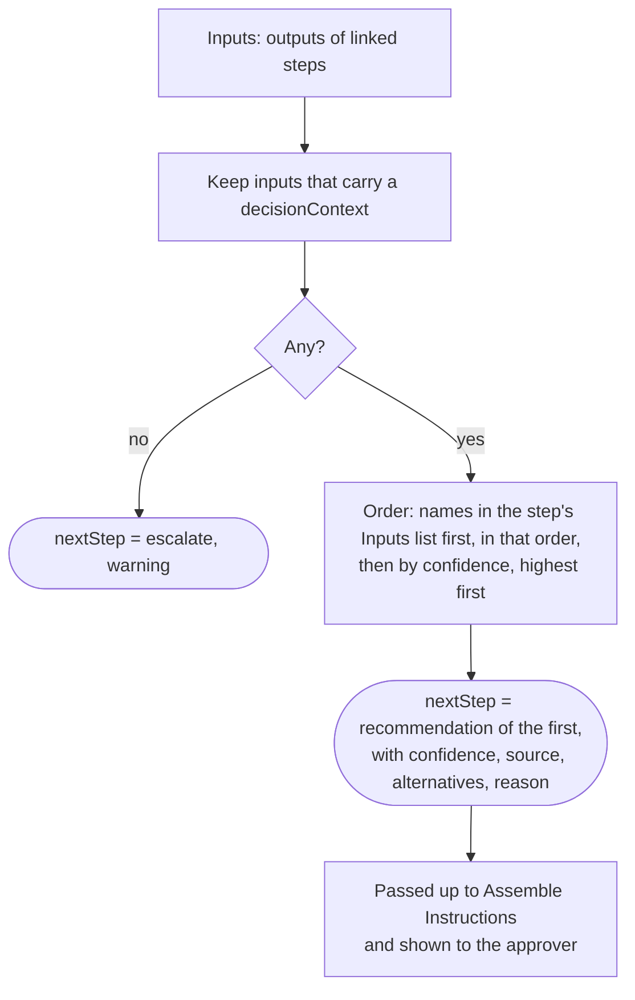

Recommendations come from the contracts' rules: e.g. optimal with turnover < 2 % → `hold` (0.9); turnover above
`maxTurnover` → `rebalance_partially`; infeasible → `rerun_relaxed`; `invalid_input` → `escalate`.

## 8. Sample: SRM Daily Refresh

Weekday 18:30 New York; opens on Mock; subscription *SRM loader service* (127.0.0.1:8770, header `X-SRM-Dry-Run: 1`).

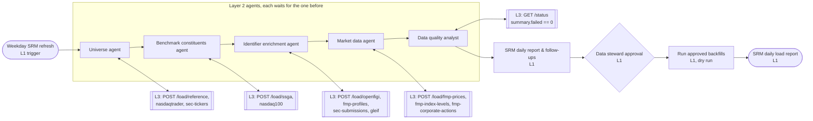

Each loader expects `status != failed`; its exception handling follows the source (retries for free reference files,
skip for optional enrichment, ask the user for constituents and prices). The status step expects `summary.failed == 0`.

## 9. Sample: Active Portfolio Optimization

Monthly rebalance review of DEMO_GROWTH (or the portfolio from MxDataHUB) against its benchmark.

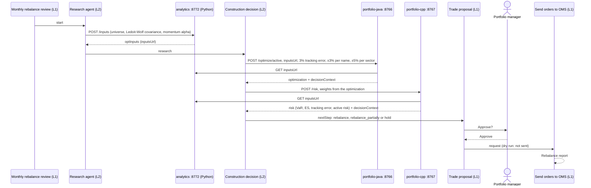

## 10. Sample: Passive Index Tracking

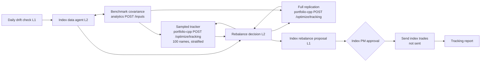

Rebalance when drift exceeds the 1 % tracking-error budget, else hold.

## 11. Sample: Performance & Risk Attribution

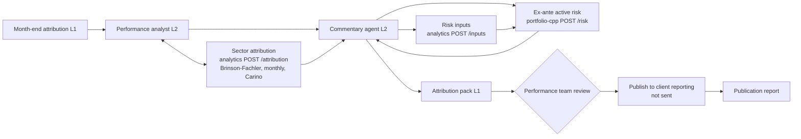

Months without their own weight snapshot are marked `review` (see MxDataHUB's snapshot history).

## 12. Open a sample from MxDataHUB

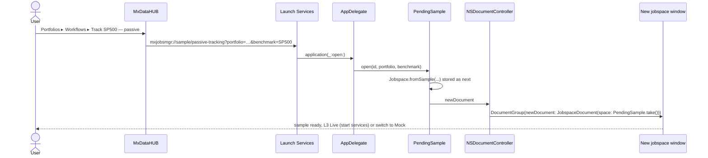
