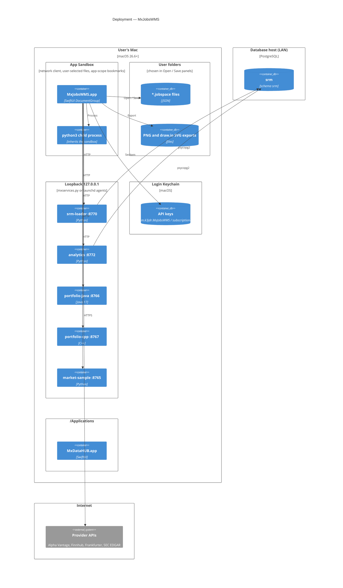

# 05 · Deployment

## Nodes

| Node                 | What runs there                                                     | How it gets there                                                                                                                                                                                                                                      | Notes                                                                                                                                                                                                             |
| ---------------------- | --------------------------------------------------------------------- | -------------------------------------------------------------------------------------------------------------------------------------------------------------------------------------------------------------------------------------------------------- | ------------------------------------------------------------------------------------------------------------------------------------------------------------------------------------------------------------------- |
| **Mac, App Sandbox** | `MxJobsWMS.app` (`com.k3jdr.MxJobsWMS`), and Python Script children | Release build, re-signed keeping its entitlements (sandbox, network client, user-selected read-write, `files.bookmarks.app-scope`), installed in `/Applications` with `ditto`, registered with `lsregister`; zipped to `~/Downloads/MxJobsWMS-1.0.zip` | Registers `mxjobswms://` and the `.jobspace` type. Python children see only the network and the app's container — not the user's files, `/tmp`, or interpreters and `pip --user` packages under the home folder. |
| **User folders**     | Jobspace files, exports                                             | Open / Save panels (user-selected access)                                                                                                                                                                                                              | Files can be shared: they hold no keys.                                                                                                                                                                           |
| **Loopback**         | Layer 3 services                                                    | `python3 Services/mxservices.py start` / `install-agents`                                                                                                                                                                                              | Outside the sandbox: they may use files, databases, licences and credentials.                                                                                                                                     |
| **Login Keychain**   | API keys                                                            | API Subscriptions ▸ Save Key                                                                                                                                                                                                                          | Re-enter keys on another Mac.                                                                                                                                                                                     |
| **Database host**    | PostgreSQL `srm`                                                    | —                                                                                                                                                                                                                                                     | Reached by the services, never by MxJobsWMS.                                                                                                                                                                      |
| **Internet**         | Provider APIs                                                       | —                                                                                                                                                                                                                                                     | Rate limits per subscription.                                                                                                                                                                                     |

## Run modes as deployment safety

| Setting                                | Effect                                                                                | Default in samples                           |
| ---------------------------------------- | --------------------------------------------------------------------------------------- | ---------------------------------------------- |
| Layer 3 **Mock**                       | No network, no Python: generated data that passes the step's checks                   | SRM Daily Refresh, Daily Market Data Refresh |
| Layer 3 **Live**                       | Real calls; start the services first                                                  | Active, Passive, Attribution                 |
| Subscription header `X-SRM-Dry-Run: 1` | srm-loader reports commands instead of loading (status still reads the real database) | SRM Daily Refresh                            |
| Layer 1 **Auto-approve**               | Rehearsal without prompts (approvals marked as warnings)                              | —                                           |
| Execution Request                      | Never sends; reports what it would send                                               | all                                          |
