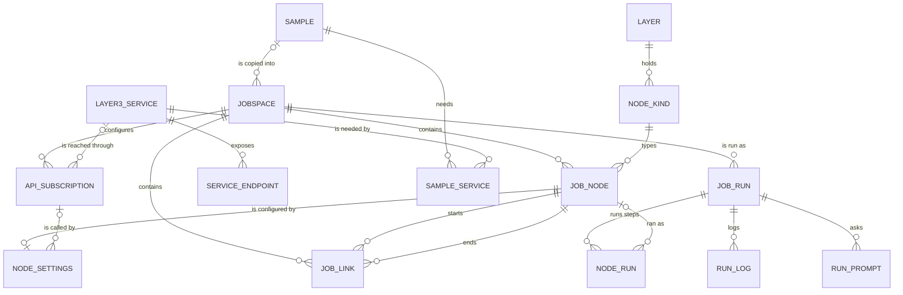
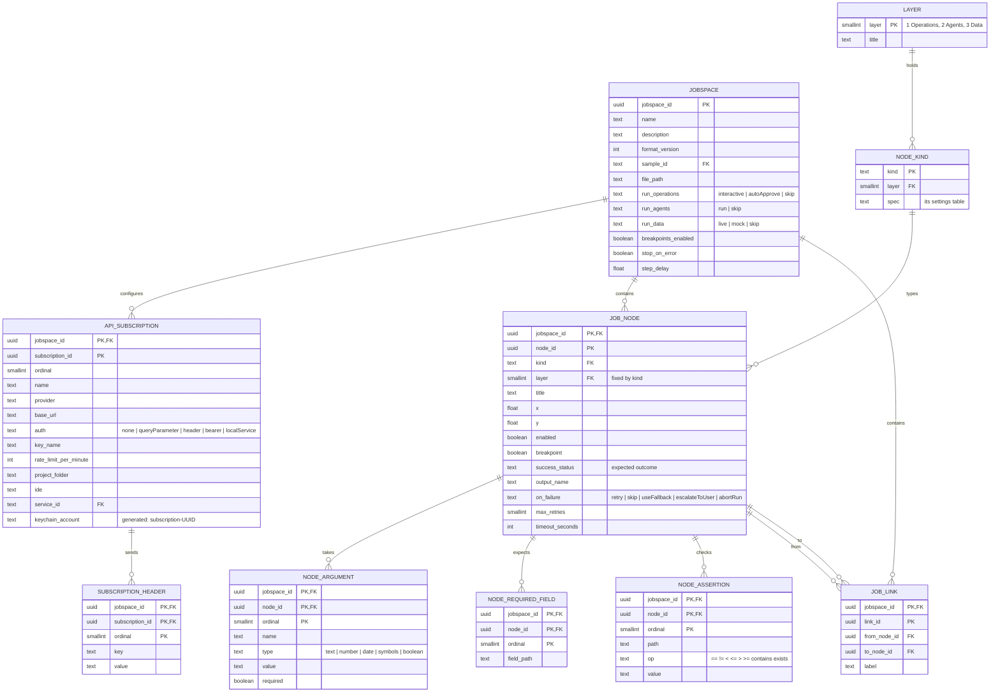
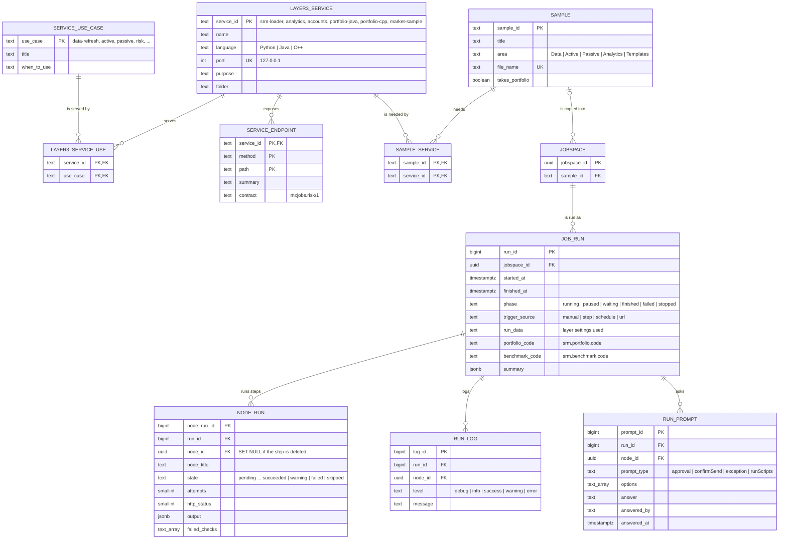

# MxJobsWMS — Entity Relationship Diagram (schema `wms`)

MxJobsWMS keeps each workflow as a `*.jobspace` JSON document today. Schema `wms` ([`ddl/install.sql`](ddl/install.sql))
is the relational form of that document — every field of the format maps to a column, and
`wms.import_jobspace` / `wms.export_jobspace` round-trip the sample files unchanged — plus the run history
the run bar produces and the Layer 3 service catalog the app shows. 30 tables.

Crow's-foot notation: `||` exactly one, `o|` zero or one, `|{` one or more, `o{` zero or more.

## 1. Overview

`NODE_SETTINGS` stands for the eight kind-specific settings tables (diagram 3).

## 2. Jobspace, subscriptions, steps and links

## 3. Kind-specific step settings (subtypes of `JOB_NODE`)

Each settings row repeats the step's `kind`, and its foreign key is `(jobspace_id, node_id, kind)` with a `CHECK` on
`kind`, so a step can only carry the settings of its own kind.

```mermaid
erDiagram
    JOB_NODE {
        uuid jobspace_id PK
        uuid node_id PK
        text kind
    }
    NODE_SCHEDULE {
        uuid node_id PK, FK "kind = trigger"
        text mode "manual | daily | weekdays | interval"
        text run_time
        text time_zone
        int interval_minutes
    }
    NODE_AGENT {
        uuid node_id PK, FK "instructionSet, agentTask, aggregate, decision"
        text instructions
        text model
        text output_format
    }
    NODE_AGENT_INPUT {
        uuid node_id PK, FK
        smallint ordinal PK "priority order"
        text input_name
    }
    NODE_APPROVAL {
        uuid node_id PK, FK "kind = approvalGate"
        text approver
        text channel "inApp | email | message"
        int expires_after_minutes
        boolean require_comment
    }
    NODE_EXECUTION {
        uuid node_id PK, FK "kind = executeRequest"
        text target
        text mode "dryRun | paper | live"
        boolean confirm_before_send
    }
    NODE_REPORT {
        uuid node_id PK, FK "kind = outcomeReport"
        text recipients
        boolean detailed
    }
    NODE_API_CALL {
        uuid node_id PK, FK "kind = apiRead"
        uuid subscription_id FK
        text method "GET | POST"
        text path
        text body
    }
    NODE_API_PARAM {
        uuid node_id PK, FK
        text location PK "query | header"
        smallint ordinal PK
        text key
        text value
    }
    NODE_SCRIPT {
        uuid node_id PK, FK "kind = pythonScript"
        text code
        text interpreter
        uuid subscription_id FK
    }
    NODE_TRANSFORM_MAPPING {
        uuid node_id PK, FK "kind = dataNormalize"
        smallint ordinal PK
        text target
        text source_path
    }
    API_SUBSCRIPTION {
        uuid subscription_id PK
    }

    JOB_NODE ||--o| NODE_SCHEDULE : "trigger"
    JOB_NODE ||--o| NODE_AGENT : "agent steps"
    NODE_AGENT ||--o{ NODE_AGENT_INPUT : reads
    JOB_NODE ||--o| NODE_APPROVAL : "approval"
    JOB_NODE ||--o| NODE_EXECUTION : "execution"
    JOB_NODE ||--o| NODE_REPORT : "report"
    JOB_NODE ||--o| NODE_API_CALL : "API read"
    NODE_API_CALL ||--o{ NODE_API_PARAM : sends
    JOB_NODE ||--o| NODE_SCRIPT : "Python"
    JOB_NODE ||--o{ NODE_TRANSFORM_MAPPING : "normalize"
    API_SUBSCRIPTION |o--o{ NODE_API_CALL : "is called by"
    API_SUBSCRIPTION |o--o{ NODE_SCRIPT : "keys"
```

(All settings and list tables also carry `jobspace_id` as the first key column; it is left out above for space.)

## 4. Layer 3 services, samples and run history

## Cross-application references

| From                                            | To                                                    | How                                                                          |
| ------------------------------------------------- | ------------------------------------------------------- | ------------------------------------------------------------------------------ |
| `wms.job_run.portfolio_code` / `benchmark_code` | MxDataHUB `srm.portfolio.code` / `srm.benchmark.code` | by code, as passed in `mxjobswms://sample/<id>?portfolio=&benchmark=`        |
| `wms.api_subscription.keychain_account`         | login Keychain, service `com.k3jdr.MxJobsWMS`         | API keys are never stored in the database                                    |
| `wms.layer3_service`                            | `MXcodeIDE/Services/<folder>`                         | the service code; MxPortMGR's `pmg.engine_run.service_id` names the same ids |
