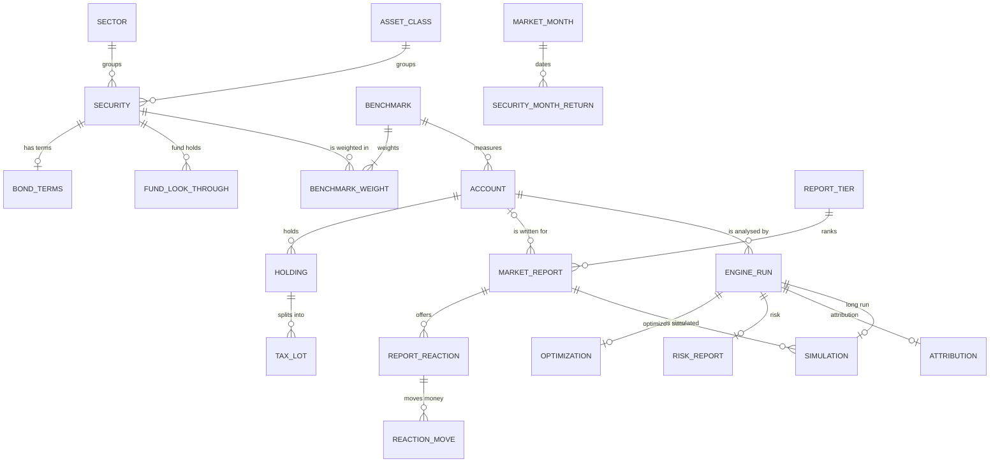
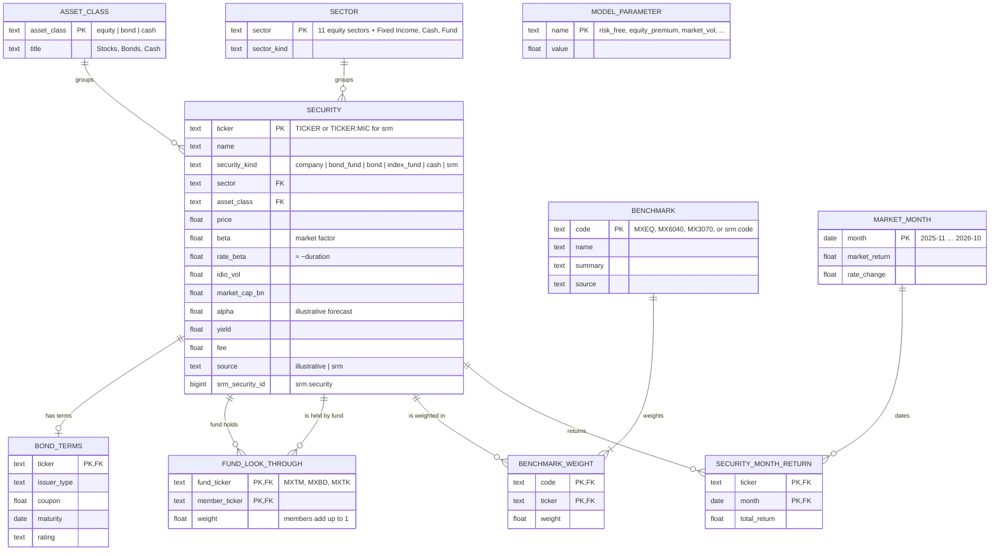
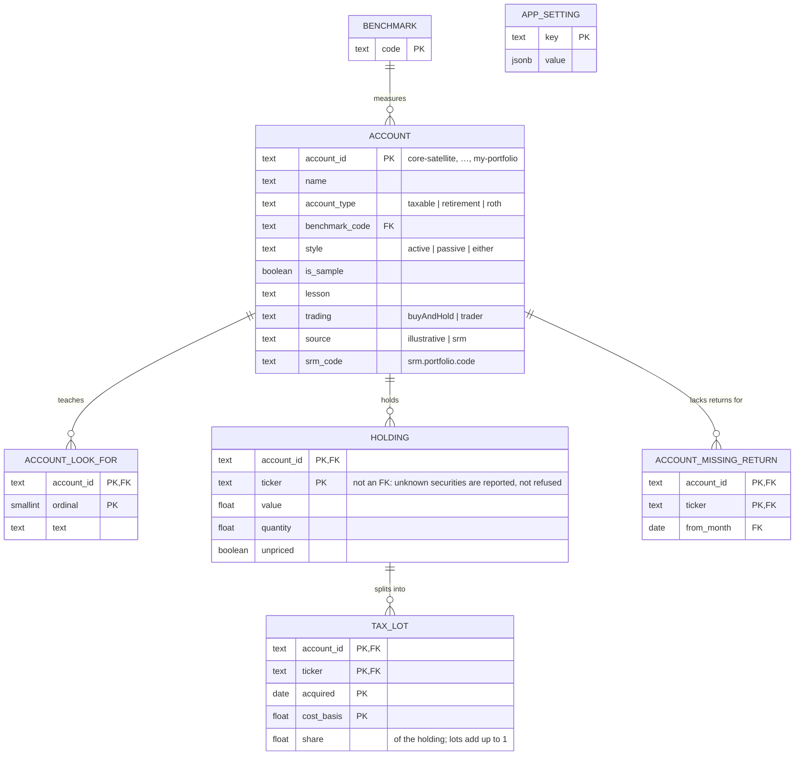
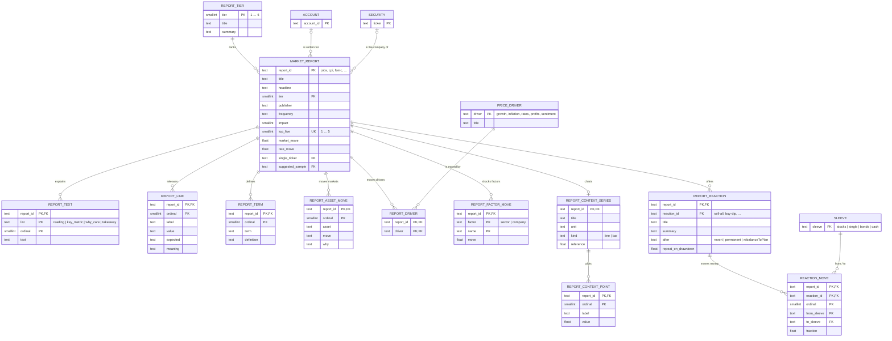

# MxPortMGR — Entity Relationship Diagram (schema `pmg`)

MxPortMGR keeps its illustrative market, samples and reports in Swift and My Portfolio in UserDefaults; in
security-master mode My Portfolio lives in MxDataHUB's `srm.portfolio` / `srm.portfolio_tax_lot` (see
[MxDataHUB's ERD](../../MxDataHUB/data-model/erd.md)). Schema `pmg` ([`ddl/install.sql`](ddl/install.sql)) is the
relational form of what the app holds, seeded from the app's own model, plus the engines' results. 50 tables.

Crow's-foot notation: `||` exactly one, `o|` zero or one, `|{` one or more, `o{` zero or more.

## 1. Overview

## 2. The illustrative market

## 3. Accounts, holdings and tax lots

## 4. Market reports and reactions

## 5. Engine results

```mermaid
erDiagram
    ACCOUNT {
        text account_id PK
    }
    ENGINE_RUN {
        bigint run_id PK
        text account_id FK
        text analysis "active_optimization | index_tracking | risk | attribution | simulation"
        text engine "builtIn | services"
        text service_id "wms.layer3_service"
        text benchmark_code
        jsonb holdings
        float milliseconds
    }
    OPTIMIZATION {
        bigint run_id PK, FK
        float tracking_error_target "settings ..."
        int max_names
        text status "result ..."
        float tracking_error
        float information_ratio
        float active_share
        float turnover
        text recommendation "rebalance | rebalance_partially | hold | rerun_relaxed | escalate"
    }
    OPTIMIZATION_WEIGHT {
        bigint run_id PK, FK
        text ticker PK
        float weight
    }
    OPTIMIZATION_TRADE {
        bigint run_id PK, FK
        text ticker PK
        float from_weight
        float to_weight
        text route
    }
    OPTIMIZATION_CONSTRAINT {
        bigint run_id PK, FK
        smallint ordinal PK
        text text
    }
    OPTIMIZATION_SECTOR {
        bigint run_id PK, FK
        text sector PK, FK
        float active_weight
    }
    TAX_ESTIMATE {
        bigint run_id PK, FK
        text lot_order "fifo | hifo"
        float tax
    }
    TAX_ESTIMATE_LINE {
        bigint run_id PK, FK
        text ticker PK
        date acquired PK
        float sold
        float gain
        boolean short_term
    }
    RISK_REPORT {
        bigint run_id PK, FK
        float volatility
        float tracking_error
        float beta
        float var95_month
        float es95_month
    }
    RISK_CONTRIBUTION {
        bigint run_id PK, FK
        text basis PK "security | sector | active"
        text name PK
        float weight
        float share
    }
    ATTRIBUTION {
        bigint run_id PK, FK
        text method "brinson-fachler | brinson-hood-beebower"
        float portfolio_return
        float benchmark_return
        float allocation
        float selection
        float interaction
        float data_gap
        text recommendation "publish | review"
    }
    ATTRIBUTION_GROUP {
        bigint run_id PK, FK
        text group_name PK
        float allocation
        float selection
        float interaction
    }
    ATTRIBUTION_PERIOD {
        bigint run_id PK, FK
        date month PK
        float portfolio_return
        float benchmark_return
    }
    ATTRIBUTION_CONTRIBUTOR {
        bigint run_id PK, FK
        text rank_side PK "top | bottom"
        smallint ordinal PK
        text ticker
        float contribution
    }
    ATTRIBUTION_NOTE {
        bigint run_id PK, FK
        text kind PK "reason | assumption"
        smallint ordinal PK
        text text
    }
    SIMULATION {
        bigint run_id PK, FK
        text report_id FK
        smallint years
        int paths
        text scenario FK
        numeric seed
        float start_value
    }
    SIMULATION_OUTCOME {
        bigint run_id PK, FK
        text reaction_id PK "plan or a reaction of the report"
        text report_id FK
        float median_end
        float p10_end
        float p90_end
        float missed_best_days
        float ahead_of_plan
    }
    SIMULATION_PATH {
        bigint run_id PK, FK
        text reaction_id PK, FK
        int month PK
        float median
        float low
        float high
    }
    SIMULATION_MISSING_BEST {
        bigint run_id PK, FK
        smallint days PK
        float annual_return
    }

    ACCOUNT ||--o{ ENGINE_RUN : "is analysed by"
    ENGINE_RUN ||--o| OPTIMIZATION : "optimize / track"
    OPTIMIZATION ||--o{ OPTIMIZATION_WEIGHT : proposes
    OPTIMIZATION ||--o{ OPTIMIZATION_TRADE : trades
    OPTIMIZATION ||--o{ OPTIMIZATION_CONSTRAINT : "is bound by"
    OPTIMIZATION ||--o{ OPTIMIZATION_SECTOR : tilts
    OPTIMIZATION ||--o| TAX_ESTIMATE : "costs tax"
    TAX_ESTIMATE ||--o{ TAX_ESTIMATE_LINE : "sells lots"
    ENGINE_RUN ||--o| RISK_REPORT : risk
    RISK_REPORT ||--o{ RISK_CONTRIBUTION : "comes from"
    ENGINE_RUN ||--o| ATTRIBUTION : attribution
    ATTRIBUTION ||--o{ ATTRIBUTION_GROUP : "by sector"
    ATTRIBUTION ||--o{ ATTRIBUTION_PERIOD : "by month"
    ATTRIBUTION ||--o{ ATTRIBUTION_CONTRIBUTOR : "top and bottom"
    ATTRIBUTION ||--o{ ATTRIBUTION_NOTE : explains
    ENGINE_RUN ||--o| SIMULATION : "long run"
    SIMULATION ||--|{ SIMULATION_OUTCOME : "one per strategy"
    SIMULATION_OUTCOME ||--o{ SIMULATION_PATH : "month by month"
    SIMULATION ||--o{ SIMULATION_MISSING_BEST : "missing best days"
```

## Cross-application references

| From | To | How |
|---|---|---|
| `pmg.account.srm_code` | MxDataHUB `srm.portfolio.code` (with `srm.portfolio_tax_lot`) | by code; the srm rows are the record of truth, written by the accounts service (8774) |
| `pmg.security.srm_security_id` | `srm.security.security_id` | a cached copy, keyed `TICKER:MIC` when the ticker clashes with the illustrative universe |
| `pmg.benchmark` (source `srm`) | `srm.benchmark.code` | cached weights for a security-master benchmark |
| `pmg.attribution.srm_portfolio_code` | `srm.portfolio.code` | Attribution ▸ Source: a security-master portfolio (analytics `/attribution`) |
| `pmg.engine_run.service_id` | MxJobsWMS `wms.layer3_service.service_id` | portfolio-java, portfolio-cpp, analytics |
